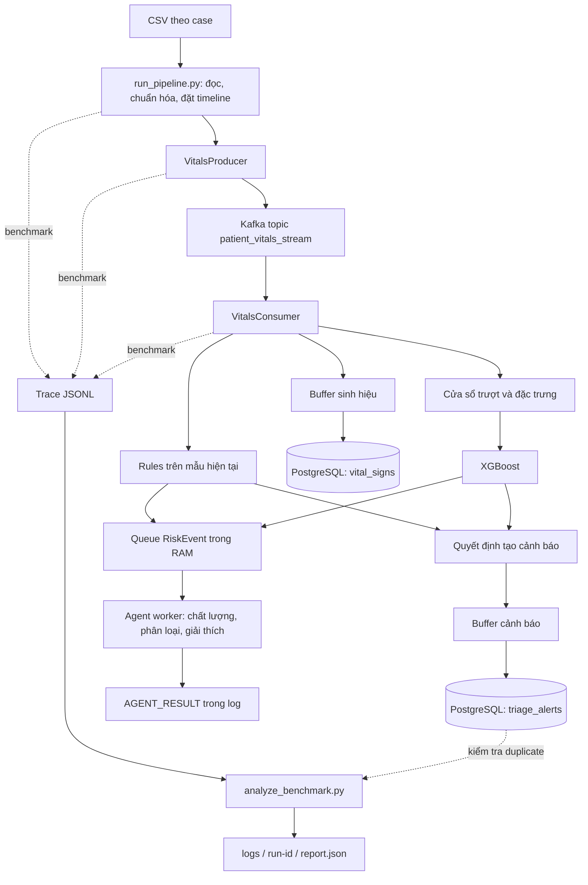

# Hiểu đồ án theo dõi sinh hiệu thời gian thực và lộ trình phát triển

Tài liệu dành cho người mới, đi theo đường đi của một mẫu dữ liệu trong dự án: **CSV → replay/producer → Kafka → consumer → rules và ML → cảnh báo/agent → PostgreSQL → log và report**.

Ngày đối chiếu: **21/10/2026**. Nguồn triển khai là code trong repository `realtime_cario_agents`, model bundle `models/heart_disease_classifier.pkl`, và hai report chạy 10 bệnh nhân ngày 19/10/2026. Đây là mô tả bản thử nghiệm nghiên cứu đang có; các mục được ghi **đề xuất** là việc chưa được xác nhận đã triển khai.

Các ngưỡng sinh hiệu và nhãn CRITICAL trong tài liệu là quy tắc phần mềm đang được dự án sử dụng. Chúng không thay thế đánh giá chuyên môn y tế. Tài liệu tập trung vào kiến thức phần mềm, học máy và phương pháp thực nghiệm.

## Cách đọc và mục lục

Nếu mới bắt đầu, hãy đọc từ mục 1 đến 12 trước khi đọc các metric và hướng nghiên cứu. Mỗi phần liên hệ khái niệm với file thực tế, để có thể vừa đọc vừa mở code.

1. [Đồ án giải quyết bài toán gì?](#bai-toan)
2. [Bản đồ kiến trúc và mã nguồn](#kien-truc)
3. [Nguồn dữ liệu, định danh và thời gian](#du-lieu)
4. [Replay và nhiều bệnh nhân đồng thời](#replay)
5. [Kafka: hàng đợi, partition và offset](#kafka)
6. [Consumer và các điểm hoàn thành](#consumer)
7. [Rules: phát hiện trạng thái hiện tại](#rules)
8. [Cửa sổ trượt và dữ liệu thiếu](#window)
9. [XGBoost: dự báo và giới hạn model đang dùng](#ml)
10. [Agent: tổng hợp và giải thích](#agent)
11. [PostgreSQL: sinh hiệu, cảnh báo và tính nhất quán](#database)
12. [Docker, cấu hình và file đầu ra](#docker)
13. [Quan sát hệ thống và M1–M10](#metrics)
14. [Baseline, fault và cách đọc hai report 10 bệnh nhân](#thuc-nghiem)
15. [Kiến thức đánh giá học máy cần bổ sung](#danh-gia-ml)
16. [Những giới hạn cần biết của bản hiện tại](#gioi-han)
17. [Phát triển thành đồ án tốt nghiệp hoặc luận văn](#phat-trien)
18. [Lộ trình triển khai và thiết kế thí nghiệm](#lo-trinh)
19. [Lộ trình học, câu hỏi ôn tập và từ điển](#hoc-tap)
20. [Giáo trình và tài liệu chính thức](#tai-lieu)

<a id="bai-toan"></a>
## 1. Đồ án giải quyết bài toán gì?

### 1.1. Bài toán bằng ngôn ngữ đơn giản

Giả sử có nhiều bệnh nhân đang được theo dõi. Mỗi người liên tục phát sinh nhịp tim, SpO₂, huyết áp và các sinh hiệu khác. Phần mềm cần tiếp nhận dữ liệu, nhận biết mẫu vượt ngưỡng, thử dự báo rủi ro sắp xuất hiện, lưu lịch sử và giải thích vì sao có cảnh báo.

Dự án hiện dùng CSV thay cho thiết bị thật. Việc đọc từng dòng theo thời gian gọi là **replay**: phát lại một bản ghi quá khứ để thử cách một hệ thống trực tuyến xử lý nó. Replay giúp thực nghiệm có thể lặp lại mà không cần kết nối monitor bệnh nhân.

### 1.2. Ba bài toán khác nhau trong cùng một pipeline

| Bài toán | Câu hỏi cần trả lời | Thành phần hiện có |
|---|---|---|
| Vận chuyển và lưu dữ liệu | Mẫu có tới nơi, đúng thứ tự cần thiết và đúng hạn không? | Producer, Kafka, consumer, PostgreSQL |
| Phát hiện hiện tại | Sinh hiệu ở mẫu hiện tại có vượt ngưỡng của rules không? | `RuleEngine` |
| Dự báo tương lai | Dựa trên lịch sử đến hiện tại, có dấu hiệu một đợt critical mới sắp xuất hiện không? | Đặc trưng cửa sổ, XGBoost, chính sách agent |

Một hệ thống lưu đủ dữ liệu vẫn có thể cảnh báo trễ. Một model cho điểm khác nhau vẫn có thể dự đoán sai. Một lời giải thích dễ đọc vẫn chưa chứng minh dự báo đúng. Vì vậy, phải đánh giá riêng ba bài toán này.

### 1.3. Kết quả đầu ra đang có

- **Sinh hiệu và cảnh báo** trong PostgreSQL.
- **Log vận hành** của runner và consumer; kết quả agent xuất thành dòng `AGENT_RESULT` trong log.
- **Trace đo lường** để ghép các mốc xử lý theo từng mẫu khi bật benchmark.
- **`report.json`** tổng hợp một lượt chạy có metrics.

Đối tượng mà runner gọi là `case` là một ca mổ. Một người có thể có nhiều ca; do đó số case không luôn bằng số bệnh nhân khác nhau. Muốn khẳng định chạy 50 bệnh nhân phải kiểm tra 50 `patient_id` tương ứng.

<a id="kien-truc"></a>
## 2. Bản đồ kiến trúc và mã nguồn

### 2.1. Sơ đồ luồng thực tế



Nhánh agent chạy nền nhưng vẫn ở cùng process/container với consumer. Khi pause container này, cả consumer lẫn agent và monitor nội bộ đều bị pause. Cảnh báo DB được consumer tạo; agent không trực tiếp quyết định việc insert cảnh báo vào bảng hiện tại.

### 2.2. File nào phụ trách việc gì?

Các đường dẫn trong bảng tính từ thư mục gốc repository.

| Đường dẫn | Vai trò | Khi nào nên đọc? |
|---|---|---|
| `scripts/run_pipeline.py` | Điều phối replay, worker và kiểm tra kết quả DB | Hiểu lệnh chạy đang làm gì |
| `src/realtime_medical/generator/sensor_simulator.py` | Có `_build_vitals_row()` dùng để chuẩn hóa một dòng CSV | Hiểu mapping dữ liệu nguồn |
| `src/realtime_medical/streaming/producer.py` | Đóng gói JSON, gửi Kafka, nhận callback | Hiểu enqueue và ACK |
| `src/realtime_medical/streaming/consumer.py` | Nhận message, gọi rules/ML, buffer, gửi agent, flush DB | Hiểu luồng xử lý trung tâm |
| `src/realtime_medical/triage/rules.py` | Các luật ngưỡng và gộp mức nguy hiểm | Hiểu CRITICAL hiện tại |
| `src/realtime_medical/streaming/windowing.py` | Lọc artifact, forward-fill có hạn, tính đặc trưng | Hiểu đầu vào model |
| `src/realtime_medical/triage/trigger_model.py` | Load bundle, sắp đặc trưng, suy luận và so ngưỡng | Hiểu `model_score` |
| `src/realtime_medical/agent/` | Snapshot, policy, queue, graph, giải thích | Hiểu agent thực sự làm gì |
| `src/realtime_medical/db/client.py` | Ghi DB và quản lý transaction | Hiểu ACK lưu dữ liệu |
| `db/schema_1.sql` | Định nghĩa bảng, khóa chính, khóa ngoại, index | Hiểu quan hệ dữ liệu |
| `src/realtime_medical/utils/measured_run.py` | Vòng đời lượt đo, controller fault và xuất report | Hiểu bật metrics khác chạy thường ở đâu |
| `src/realtime_medical/utils/benchmark_hooks.py` | ID mẫu, deadline và các mốc trace | Hiểu mẫu số và thời điểm đo |
| `src/realtime_medical/utils/benchmark_reference.py` | Rules tham chiếu trên raw input cho benchmark | Hiểu ground truth của M4/M7 |
| `src/realtime_medical/utils/benchmark_analysis.py` | Hàm tính deadline, latency, RTO, backlog, duplicate | Hiểu công thức trong report |
| `scripts/analyze_benchmark.py` | Ghép trace và tạo các mục M1–M10 | Đối chiếu số liệu report |
| `configs/config.yaml`, `src/realtime_medical/config.py` | Cấu hình và kiểu dữ liệu cấu hình | Hiểu tham số thực sự có hiệu lực |
| `Dockerfile`, `docker-compose.yml` | Đóng gói ứng dụng và dựng hạ tầng | Hiểu host/container và build |
| `test/` | Các kiểm thử hiện có | Hiểu hành vi đã được kiểm tra ở mức code |

Một số comment cũ còn dùng tên bảng như `vitals_stream`; schema và câu lệnh SQL thực tế mới là căn cứ. Bảng sinh hiệu hiện tại là `vital_signs`.

<a id="du-lieu"></a>
## 3. Nguồn dữ liệu, định danh và thời gian

### 3.1. Các sinh hiệu đang dùng

| Key chuẩn | Ý nghĩa | Đơn vị quy ước trong dự án | Cột nguồn đang map |
|---|---|---|---|
| `hr` | Nhịp tim | nhịp/phút | `Solar8000/HR` |
| `spo2` | SpO₂ | % | `Solar8000/PLETH_SPO2` |
| `sbp` | Huyết áp tâm thu | mmHg | `Solar8000/NIBP_SBP` |
| `dbp` | Huyết áp tâm trương | mmHg | `Solar8000/NIBP_DBP` |
| `mbp` | Huyết áp trung bình | mmHg | `Solar8000/NIBP_MBP` |
| `rr` | Nhịp thở | lần/phút | `Solar8000/RR_CO2` |
| `bt` | Nhiệt độ | °C | `Solar8000/BT` |

**Chuẩn hóa tên** là đổi tên của thiết bị thành tên mà toàn hệ thống hiểu thống nhất. Ví dụ `Solar8000/HR` thành `hr`. Đây không phải chuẩn hóa thống kê như biến đổi về trung bình 0, độ lệch chuẩn 1.

Các cột không nhất thiết đều có giá trị ở mọi thời điểm. Huyết áp đo gián đoạn và tín hiệu liên tục có thể khác nhịp lấy mẫu; không nên coi mọi ô trống là cùng một loại lỗi. Khi bổ sung thiết bị khác, cần xác nhận cả đơn vị, timestamp và ý nghĩa phép đo, không chỉ đổi tên cột.

### 3.2. Dữ liệu tĩnh và dữ liệu động

**Dữ liệu tĩnh** thay đổi ít trong một ca: tuổi, giới tính, BMI, ASA, thông tin ca mổ. Chúng được seed từ CSV lâm sàng vào bảng `patient` và `surgeries`.

**Dữ liệu động** là chuỗi sinh hiệu theo thời gian trong `data/streaming/case_<id>_numerics.csv`. Consumer vừa dùng mẫu hiện tại, vừa tích lũy lịch sử để tính đặc trưng.

`caseid` và `subjectid` trong CSV lâm sàng liên hệ với ca và bệnh nhân. Không nên đưa ID bệnh nhân vào model như một đặc trưng dự báo thông thường: model có thể học thuộc danh tính thay vì quy luật khái quát.

Schema và tên kênh nguồn có thể đối chiếu với [tài liệu dataset VitalDB](https://vitaldb.net/dataset/). Tên cột giống nhau chưa đủ chứng minh toàn bộ quá trình trích xuất và quyền phân phối dữ liệu; khi làm báo cáo cần lưu nguồn tải, phiên bản, cách xuất CSV và điều kiện sử dụng thực tế.

### 3.3. Ví dụ một message

Ví dụ minh họa cấu trúc, không phải dữ liệu bệnh nhân thật:

```json
{
  "surgery_id": 10,
  "patient_id": "example-patient",
  "recorded_at": "2026-10-21T01:00:05.000000+00:00",
  "time_sec": 5.0,
  "hr": 85.0,
  "spo2": 97.0,
  "produced_at": 1792544405.0
}
```

Các trường sinh hiệu thiếu có thể bị bỏ khỏi payload. `.get("sbp")` lúc đó trả `None`. `None` không có nghĩa huyết áp bằng 0. Khi chuyển sang DataFrame số thực để suy luận, giá trị thiếu được biểu diễn bằng `NaN`.

### 3.4. Ba loại thời gian dễ nhầm

1. **Thời gian sự kiện:** mốc dữ liệu nói đến, ở đây là `recorded_at` và timeline `time_sec` được runner ánh xạ sang thời điểm replay.
2. **Thời gian xử lý:** lúc consumer, rules, model hoặc DB thực hiện công việc.
3. **Thời gian quan sát:** thời điểm cuối mà phép đo còn theo dõi kết quả của một lượt.

Ví dụ mẫu được phát ở giây 5, rules phát hiện ở giây 5,1, nhưng DB ghi ở giây 20. Phát hiện mất 0,1 giây, còn nguồn → DB mất 15 giây. Hai kết luận này có thể cùng đúng.

Trong replay CSV có metrics hiện tại, `MeasureRun` đặt `BENCH_SCHEDULED_REPLAY=0`, nên `t0_ns` thường là thời điểm runner chuẩn bị gửi mẫu sau bước chờ realtime. Nó không mặc nhiên bao gồm toàn bộ chậm trễ so với lịch nguồn dự kiến. Probe sử dụng mốc theo lịch riêng. Khi so sánh latency phải ghi rõ định nghĩa mốc nguồn này.

<a id="replay"></a>
## 4. Replay và nhiều bệnh nhân đồng thời

### 4.1. Runner thực hiện những bước nào?

`run_pipeline.py` kiểm tra DB và Kafka, xác nhận từng `surgery_id` có trong DB và có CSV, tạo worker, rồi phát dữ liệu. Các worker dùng chung một producer; một `threading.Event` được dùng để nhả các worker ban đầu.

Trong mỗi dòng CSV, runner:

1. Dùng mapping trong YAML để tạo sinh hiệu chuẩn.
2. Bỏ dòng không có sinh hiệu dùng được theo mapping.
3. Lấy `time_sec`, hoặc chỉ số dòng khi giá trị này thiếu.
4. Tạo `recorded_at` từ mốc bắt đầu replay cộng `time_sec`.
5. Bỏ timestamp trùng trong cùng case để khớp khóa chính DB.
6. Chờ đúng mốc nếu có `--realtime`.
7. Gắn expectation/trace nếu bật metrics, rồi gửi Kafka.

Do có bước bỏ dòng, `--max-rows 1200` là giới hạn dòng CSV được đọc, không phải lời hứa có 1.200 mẫu hợp lệ. Thời lượng còn phụ thuộc `time_sec`; 1.200 dòng không luôn tương đương 20 phút.

### 4.2. Worker là gì?

Một **thread** là một luồng thực thi trong process. Thread replay chủ yếu đọc và chờ lịch gửi, nên có thể dùng nhiều thread để mô phỏng nhiều nguồn cùng hoạt động.

Nếu chọn 4 case nhưng chỉ có 3 worker, một case phải chờ worker rảnh. Nếu chọn 50 case và muốn cả 50 bắt đầu trong đợt đầu, có thể đặt 50 replay worker. Điều đó không chứng minh máy xử lý được tải phía sau; vẫn phải đo Kafka lag, CPU, RAM, buffer và deadline.

Phân biệt ba con số:

| Tham số/thành phần | Nó song song hóa việc gì? |
|---|---|
| `--workers` | Các nguồn replay CSV trên host |
| Số consumer trong cùng group | Nhận/xử lý các partition Kafka |
| `ML_INFERENCE_N_JOBS` | Tài nguyên tính toán nội bộ mà model cho phép dùng |

Tăng replay worker không tự tạo thêm consumer. Trong code hiện tại, consumer xử lý từng message trong vòng poll; agent có một worker nền riêng.

### 4.3. Khái niệm tải, năng lực xử lý và backlog

Gọi `λ` là tốc độ vào, `μ` là tốc độ xử lý. Khi tốc độ vào cao hơn tốc độ ra trong một khoảng, hàng chờ tăng lên. Nếu hệ thống tiếp tục có tải thì cần dư năng lực xử lý để kéo backlog xuống.

Ví dụ giả định: vào 50 mẫu/giây, xử lý được 40 mẫu/giây. Sau 10 giây hệ thống tích thêm khoảng 100 mẫu chưa xử lý. Đây là ví dụ tính toán, không phải năng lực đã đo của dự án.

Trong mô hình đơn giản, với backlog ban đầu `B` và tốc độ giữ ổn định `μ > λ`, thời gian đưa tổng backlog về nền xấp xỉ `B / (μ - λ)`. Nếu chỉ quan tâm hoàn thành một tập mẫu cũ cố định, cách tính và ý nghĩa sẽ khác; đó là lý do không đồng nhất M9 với toàn hệ thống đã phục hồi.

**Backpressure** là cơ chế buộc phía trước chậm lại hoặc điều tiết khi phía sau không theo kịp. Một queue có giới hạn chỉ giúp chặn RAM tăng vô hạn; vẫn cần chính sách khi queue đầy. Agent hiện báo lỗi khi không tiếp nhận được sự kiện, chưa có hàng đợi bền vững để tự phát lại.

<a id="kafka"></a>
## 5. Kafka: hàng đợi, partition và offset

### 5.1. Vì sao cần Kafka ở giữa?

Kafka tách tốc độ phát dữ liệu khỏi tốc độ xử lý. Producer có thể gửi trong khi consumer bận, và dữ liệu đã được broker chấp nhận có thể chờ consumer đọc trong giới hạn lưu trữ/cấu hình của Kafka.

Ví dụ khi consumer bị pause, producer vẫn gửi, Kafka tiếp tục giữ dữ liệu, rồi consumer đọc tiếp khi hoạt động lại. Điều này giúp tránh việc hai phía phải chạy cùng một nhịp, nhưng không bảo đảm cảnh báo vẫn đúng hạn khi bên xử lý dừng.

### 5.2. Các khái niệm tối thiểu

| Khái niệm | Cách hiểu | Áp dụng vào dự án |
|---|---|---|
| Broker | Máy chủ Kafka | Service `kafka` |
| Topic | Tên một luồng sự kiện | `patient_vitals_stream` mặc định |
| Partition | Một phần log có thứ tự riêng | Compose tạo mặc định 3 partition |
| Key | Giá trị dùng chọn partition | Code gửi `key=str(surgery_id)` |
| Offset | Vị trí của message trong một partition | Dùng theo dõi tiến độ đọc |
| Consumer group | Các consumer chia nhau partition | `medical-triage-group` |
| Lag | Độ chênh tiến độ đọc so với dữ liệu trong Kafka | Cần theo dõi khi tăng tải |

Lưu ý comment cũ trong producer có nhắc `patient_id`, nhưng **key thực tế đang là `surgery_id`**. Với partitioning ổn định, các message cùng ca được đưa vào cùng partition. Kafka cung cấp thứ tự trong partition, không tạo một thứ tự toàn cục giữa mọi bệnh nhân. Đọc nền tảng tại [Apache Kafka Introduction](https://kafka.apache.org/24/getting-started/introduction/).

### 5.3. Ba mức “đã gửi” không giống nhau

```text
produce() nhận vào queue client
        ↓
callback xác nhận Kafka ACK
        ↓
consumer đọc và xử lý
        ↓
transaction PostgreSQL commit
```

`send_vital_sign()` trả `True` chỉ xác nhận enqueue thành công ở client. Producer có callback để ghi thành công/thất bại và `flush()` để chờ các callback còn lại. Producer bật `enable.idempotence=True` và `acks=all`.

Idempotent producer giúp xử lý lặp do retry ở phần gửi Kafka; nó không tự làm lệnh insert PostgreSQL trở thành chống trùng. `acks=all` cũng không tạo thêm bản sao broker: Compose hiện chỉ có một broker, topic replication factor 1. Mất broker/máy host vẫn khác hoàn toàn pause một consumer.

### 5.4. Delivery semantics: bài học hệ phân tán quan trọng nhất

- **At-most-once:** ưu tiên không xử lý lặp nhưng có thể bỏ sót khi lỗi.
- **At-least-once:** có thể xử lý lặp; cần chống trùng ở đầu ra.
- **Exactly-once effect:** mỗi sự kiện logic tạo đúng một hiệu ứng cuối cùng trong phạm vi bảo đảm đã định nghĩa.

Code consumer hiện không tắt auto-commit offset và không thấy cơ chế commit offset theo transaction DB đã hoàn thành. Đọc message, commit offset và commit DB là các việc khác nhau. Nếu tiến độ đọc được commit trước khi buffer ghi DB, crash có thể khiến dữ liệu trong RAM không được tự đọc lại. Nếu DB đã commit nhưng offset chưa commit, replay có thể tạo hiệu ứng lặp nếu đầu ra không idempotent.

Vì vậy, hiện chưa đủ cơ sở tuyên bố exactly-once hoặc crash-safe end-to-end. Một hướng cải tiến là kiểm soát offset theo partition sau khi side effect cần thiết đã bền vững, kết hợp khóa idempotency trong DB và thí nghiệm crash tại các điểm nhạy cảm. Tham khảo [Kafka Design](https://kafka.apache.org/34/design/design/) và [cấu hình librdkafka](https://docs.confluent.io/platform/current/clients/librdkafka/html/md_CONFIGURATION.html).

### 5.5. `latest` và scale consumer

`auto.offset.reset='latest'` áp dụng khi không có offset hợp lệ, không có nghĩa mỗi lần poll đều bỏ qua mọi dữ liệu cũ. Runner có metrics chờ `consumer_assigned` trước khi phát nguồn để giảm nguy cơ gửi trước khi consumer sẵn sàng.

Với consumer group kiểu đang dùng, mỗi partition được một consumer của group xử lý tại một thời điểm; 3 partition không giúp 50 consumer cùng chia được 50 phần công việc. Khi scale phải tính cả trạng thái cửa sổ: partition chuyển sang consumer khác thì bộ nhớ lịch sử của ca không tự chuyển theo. Cần chiến lược checkpoint/warm-up trước khi coi dự báo trên worker mới là tương đương. Xem [Kafka Consumer Configs](https://kafka.apache.org/34/configuration/consumer-configs/).

<a id="consumer"></a>
## 6. Consumer và các điểm hoàn thành

### 6.1. Vòng xử lý một message

Consumer đọc JSON, kiểm tra `surgery_id`/`recorded_at`, và khi bật benchmark thì lọc đúng run ID. Sau đó nó thêm raw reading vào buffer sinh hiệu, chạy rules, cập nhật đặc trưng và suy luận ML nếu đến nhịp, quyết định cảnh báo, gửi snapshot sang agent, rồi kiểm tra có cần flush DB không.

Các bước rules và model không chạy thành hai dịch vụ độc lập trong bản này; chúng được gọi trong luồng xử lý consumer. Vì vậy suy luận ML quá chậm vẫn có thể làm message phía sau chờ, dù agent đã được tách sang thread nền.

### 6.2. Những mốc cần phân biệt

| Mốc | Chứng minh điều gì? | Chưa chứng minh điều gì? |
|---|---|---|
| `consumer_received` | Consumer đã nhận mẫu | Chưa biết rules/DB đã xong |
| `critical_detected` | Rules trả CRITICAL | Chưa gồm agent, chưa bảo đảm lưu alert |
| `alert_generated` | Đã tạo cảnh báo trong RAM | Chưa có transaction DB thành công |
| `vitals_persisted` | Tầng ghi sinh hiệu trả thành công/đã xử lý khóa | Không phải bằng chứng nhận thức của người dùng |
| `alert_persisted` | Tầng ghi cảnh báo trả thành công sau commit | Chưa có cơ chế xác nhận bác sĩ đã nhận/xem |
| `AGENT_RESULT` | Agent đã xuất kết quả vào log | Không thay thế ACK cảnh báo DB hoặc thông báo người dùng |

Thí dụ: rules phát hiện trong 80 ms, cảnh báo nằm trong buffer 18 giây rồi mới được commit. Pipeline phát hiện nhanh nhưng lưu trễ. Không được chỉ dùng thời gian chạy model để mô tả toàn bộ độ trễ cảnh báo.

### 6.3. Buffer, batch và đánh đổi latency/throughput

**Buffer** là chỗ giữ tạm trong RAM. **Batch** là nhóm nhiều bản ghi được ghi cùng lượt để giảm số lần gọi DB.

Hiện `batch_size=100`, còn `flush_interval` được consumer lấy từ `window_size_seconds=60`. Flush khi một buffer đủ batch hoặc hết thời gian chờ; nếu trước đó lỗi và còn pending thì áp dụng lịch retry khoảng 5 giây. Sinh hiệu được flush trước cảnh báo để đáp ứng khóa ngoại.

Với tốc độ vào thấp, chờ đủ 100 bản ghi có thể mất nhiều giây. Nếu một luồng đều 5 mẫu/giây và giả sử chỉ xét batch 100, thời gian gom đầy gần 20 giây; đó là ví dụ giải thích cơ chế, không phải phép chứng minh nguyên nhân của mọi mẫu trễ. Timer, tốc độ thực tế, lỗi DB và phần xử lý khác đều có thể ảnh hưởng.

Điểm thiết kế cần cải tiến là tách **cửa sổ ML 60 giây** khỏi **chu kỳ ghi DB**, vì hai tham số phục vụ hai mục tiêu khác nhau. Có thể giữ lịch sử dài để dự báo trong khi ghi critical alert sớm hơn.

<a id="rules"></a>
## 7. Rules: phát hiện trạng thái hiện tại

### 7.1. Rule-based system là gì?

Một rule là điều kiện được lập trình rõ: nếu giá trị vượt ngưỡng thì trả mức cảnh báo và lý do. `RuleEngine` chạy các rule và lấy mức nghiêm trọng cao nhất.

Ví dụ ngưỡng **đang nằm trong cấu hình/code dự án**, không phải khuyến cáo áp dụng lâm sàng:

| Nhóm | Điều kiện đang dùng |
|---|---|
| HR | `hr >= 120` hoặc `hr <= 50` → CRITICAL |
| SpO₂ | `spo2 <= 92` → CRITICAL |
| Huyết áp | SBP ngoài `[80,180]` ở biên bao gồm; DBP ngoài `[40,120]` ở biên bao gồm; hoặc MBP `<=65` → CRITICAL |
| RR | `rr >=24` hoặc `rr <=8` → CRITICAL |
| BT | `bt >=38.5` → CRITICAL; `bt <=35` → MEDIUM |
| Shock index | `hr/sbp >0.9` → CRITICAL khi đủ dữ liệu |

Trong hàng huyết áp, nói chính xác là **SBP ≤80 hoặc ≥180; DBP ≤40 hoặc ≥120**, không phải mọi giá trị trong khoảng đều bị cảnh báo. Biên bằng ngưỡng có ý nghĩa khi viết test.

### 7.2. Rules và ML dùng dữ liệu khác nhau

Rules hiện đánh giá raw reading nhận được, trước xử lý forward-fill trong nhánh ML. Nếu HR thiếu thì rule HR trả không kích hoạt; điều này không chứng minh HR an toàn, mà chỉ là rule đó chưa có dữ liệu để kiểm tra.

Nhánh tạo đặc trưng có lọc artifact cho các field được cấu hình, nhưng không được hiểu rằng raw reading đưa vào rules đã đi qua cùng bộ lọc đó. Đây là một khác biệt cần kiểm tra khi đánh giá cảnh báo do giá trị lỗi cảm biến.

### 7.3. CRITICAL khác với “một alert” thế nào?

CRITICAL là mức nguy hiểm theo rules. Alert là một bản ghi cảnh báo. Consumer hiện tạo alert khi **rules CRITICAL hoặc ML vượt ngưỡng 0,35**:

- Rules CRITICAL: lưu `risk_level=CRITICAL`.
- Chỉ ML vượt ngưỡng: lưu `risk_level=MEDIUM`.
- Cả hai cùng kích hoạt: vẫn một alert cho lần xử lý đó, gộp lý do và giữ mức CRITICAL.

Rule BT thấp có thể cho MEDIUM, nhưng riêng mức MEDIUM đó chưa đủ đi qua điều kiện insert alert hiện tại nếu ML cũng không kích hoạt. Vì vậy không nên nói mọi rule triggered đều được lưu thành cảnh báo.

Lưu chung các loại cảnh báo trong `triage_alerts` là phù hợp nếu truy vấn biết phân biệt mức và nguồn. Nếu muốn đánh giá đóng góp từng nhánh một cách bền vững, nên bổ sung trường nguồn có cấu trúc như RULE/ML/BOTH trong một thay đổi tương lai, thay vì chỉ phân tích chuỗi lý do.

<a id="window"></a>
## 8. Cửa sổ trượt và dữ liệu thiếu

### 8.1. Vì sao không đưa trực tiếp từng giá trị vào model?

Một điểm HR bằng 105 không cho biết nhịp tim vừa tăng mạnh hay đã ổn định từ lâu. Cửa sổ giúp biểu diễn diễn biến gần đây: trung bình, cực trị, mức dao động và chênh lệch đầu/cuối.

**Sliding window** giữ một đoạn lịch sử trượt theo thời gian mẫu. Cấu hình hiện tại giữ khoảng 60 giây, đánh giá cách nhau ít nhất 5 giây và cần ít nhất 5 reading. Không phải cứ đúng 5 giây đồng hồ là có dự đoán: cần có reading đến để kích hoạt logic, đồng thời đáp ứng điều kiện đủ mẫu.

`min_samples=5` cũng không đồng nghĩa đủ 60 giây lịch sử. Tại đầu ca, model có thể được gọi với cửa sổ chưa đầy; trường `window_actual_span_seconds` ghi độ dài thực tế.

### 8.2. Ví dụ tính đặc trưng

Giả sử sau bước làm sạch/điền, HR trong cửa sổ là `[80, 85, 90]`:

| Đặc trưng | Cách tính | Giá trị |
|---|---|---:|
| `hr_mean` | Trung bình cộng | 85 |
| `hr_min` | Nhỏ nhất | 80 |
| `hr_max` | Lớn nhất | 90 |
| `hr_last` | Giá trị hợp lệ cuối | 90 |
| `hr_trend` | Cuối trừ đầu | 10 |
| `hr_std` | Độ lệch chuẩn, code dùng `np.std` mặc định | Khoảng 4,08 |

`trend=10` hiện là chênh lệch giá trị, không phải 10 nhịp/phút mỗi giây và không phải hệ số hồi quy xu hướng. Dữ liệu lấy mẫu không đều làm ý nghĩa các thống kê khác với chuỗi lấy mẫu đều; đây là một chủ đề cải tiến tiền xử lý.

### 8.3. Forward-fill thực sự hoạt động thế nào?

Forward-fill là dùng giá trị hợp lệ gần nhất ở quá khứ để thay ô thiếu, trong giới hạn tuổi dữ liệu. Ví dụ có HR=80 tại giây 0:

| Lúc đọc mới | Raw HR | Giá trị đi vào cửa sổ, giả sử chưa có HR hợp lệ mới |
|---|---|---|
| Giây 5 | Thiếu | Có thể dùng lại 80 |
| Giây 10 | Thiếu | Có thể dùng lại 80 vì code cho `gap <=10` |
| Giây 11 | Thiếu | Để thiếu vì đã quá 10 giây |

Nếu chưa từng nhận HR thì không có gì để fill. Code không tự bịa một giá trị “bình thường”. Forward-fill ở đây không biến raw sample trong DB thành một phép đo mới, và không được dùng để làm mới tuổi tín hiệu trong M2.

### 8.4. Missingness có nhiều tầng

1. Field không tồn tại hoặc NaN trong CSV.
2. Giá trị bị coi là artifact ở nhánh feature.
3. Giá trị thiếu được fill từ quá khứ còn đủ mới.
4. Giá trị vẫn thiếu sau fill.
5. Cả message không đến consumer.

Các tầng này cần phân biệt. Ví dụ `hr_missing_ratio` hiện được tính trên **cửa sổ sau forward-fill**, không phải tỷ lệ raw HR thiếu ban đầu. Model có thể thấy tỷ lệ thiếu thấp dù nguồn đã có nhiều khoảng thiếu ngắn.

Một chi tiết khác: khi không đủ giá trị, một số đặc trưng như `std` hoặc `trend` được code trả 0, trong khi mean/min/max/last có thể là `None`. Model cần được huấn luyện đúng cùng ngữ nghĩa này; chỉ kiểm tra có NaN hay không là chưa đủ đánh giá chất lượng.

### 8.5. Train/serve skew và dữ liệu tương lai

**Train/serve skew** là đầu vào lúc huấn luyện và lúc chạy thật không cùng cách tính. Ví dụ train forward-fill không giới hạn nhưng runtime chỉ fill 10 giây; hoặc train dùng RR từ kênh khác runtime. Model lúc đó nhận một phân phối khác điều nó đã học.

Repository có `build_offline_windows()` dùng lại aggregator, giúp giảm nguy cơ khác logic. Tuy nhiên vẫn phải xác nhận script tạo tập train thực sự sử dụng cùng phiên bản, mapping và quy tắc bỏ dòng. File `feedback/retrain.py` hiện trống; chưa có một quy trình retrain end-to-end hoàn chỉnh ở đây.

Không dùng backward-fill từ tương lai, cửa sổ centered hoặc chuẩn hóa fit trên cả test khi làm dự báo. Khi dự đoán tại thời điểm `t`, đặc trưng chỉ được dùng thông tin đã có đến `t`. Đọc thêm về [data leakage trong scikit-learn](https://scikit-learn.org/stable/common_pitfalls.html).

<a id="ml"></a>
## 9. XGBoost: dự báo và giới hạn model đang dùng

### 9.1. Những khái niệm học máy đầu tiên

- **Feature `X`:** thông tin đầu vào, ví dụ HR trung bình, SpO₂ nhỏ nhất, tuổi.
- **Label `y`:** kết quả mà model cần học dự đoán, phải được định nghĩa trước khi train.
- **Training:** tìm tham số từ các cặp `(X,y)` trong quá khứ.
- **Inference:** dùng model đã train để tính điểm cho `X` mới.
- **Threshold:** ngưỡng biến điểm thành quyết định cảnh báo.

Decision tree chia không gian đặc trưng bằng các câu hỏi về giá trị. Gradient boosting ghép nhiều cây nhỏ, huấn luyện nối tiếp để cải thiện hàm dự đoán theo một hàm mất mát. XGBoost là một triển khai của hướng này, không phải bộ rules y tế viết tay. Tham khảo [giải thích boosted trees chính thức](https://xgboost.readthedocs.io/en/stable/tutorials/model.html).

### 9.2. Bundle trong repository đang chứa gì?

File `.pkl` là dictionary có `pipeline`, `feature_order`, `metadata`. Pipeline đọc được hiện có bước `classifier` kiểu `XGBClassifier`, không có bước imputer riêng. Loader chỉ lấy các feature có tên trong `feature_order`, sắp đúng thứ tự, chuyển sang DataFrame float và gọi `predict_proba`.

Bundle hiện chọn **30 đặc trưng**, thuộc nhóm thống kê HR/SpO₂/huyết áp/RR/BT, shock index và dữ liệu tĩnh. Không phải tất cả đặc trưng mà `WindowAggregator` tạo ra đều được đưa vào classifier.

Tên file `heart_disease_classifier.pkl` không chứng minh model đang chẩn đoán bệnh tim. **Metadata của bundle** mô tả nhiệm vụ dự báo khởi phát một đợt rule-CRITICAL mới trong 60 giây, sau giai đoạn trước đó được xác minh không critical. Rule đang critical hiện tại do rules xử lý.

Theo protocol trong metadata, đợt nhãn có điều kiện duy trì tối thiểu 5 giây, gộp gap 30 giây và có điều kiện coverage tín hiệu. Đây là định nghĩa nghiên cứu theo rules, không phải kết cục lâm sàng đã được chuyên gia gán nhãn độc lập. Các thông tin này được đọc từ bundle; tài liệu này không tái huấn luyện để xác nhận lại quy trình đó.

### 9.3. Score và threshold hiện chưa đồng bộ hoàn toàn

| Nơi định nghĩa | Giá trị đọc được | Ý nghĩa |
|---|---:|---|
| Loader `MLTriageModel.recall_threshold` | **0,35** | Ngưỡng hiện dùng để tạo alert ML ở consumer |
| Metadata `decision_threshold` | **0,2561838** | Ngưỡng được ghi là chọn từ validation |
| Agent WATCH vào/ra | **0,35 / 0,25** | Chính sách phân loại forecast có hysteresis |
| Agent HIGH vào/ra | **0,65 / 0,55** | Chính sách ưu tiên forecast cao |

Không được lấy metric validation ở ngưỡng 0,2562 rồi coi đó là metric runtime ở ngưỡng 0,35. Đây là hai quyết định khác nhau. Đổi threshold có thể thay đổi số cảnh báo, recall và precision mà không đổi trọng số model.

### 9.4. Model hỗ trợ NaN không có nghĩa dữ liệu thiếu luôn vô hại

Với cây XGBoost, cách đi nhánh cho giá trị thiếu được học trong huấn luyện. Đây là khả năng xử lý đầu vào thiếu, không bảo đảm model vẫn đúng với mọi kiểu mất tín hiệu. Nếu tập train và runtime khác mẫu hình thiếu, score vẫn có thể lệch. Thuật toán sparsity-aware được trình bày trong [bài báo XGBoost của Chen và Guestrin](https://arxiv.org/abs/1603.02754).

Ví dụ model từng thấy “thiếu huyết áp” thường đi cùng nhãn positive, nó có thể dùng missingness như một tín hiệu dự đoán. Muốn biết model đang học sinh lý hay học cách dữ liệu bị thiếu, phải làm thí nghiệm masking độc lập với nhãn và đánh giá theo nhóm chất lượng dữ liệu.

Điểm thấp có thể có nghĩa model đánh giá ít phù hợp với positive target, hoặc model bỏ sót; chỉ score không phân biệt được. Điểm gần 1 cũng không tự chứng minh đúng. Cần đối chiếu với label đúng nhiệm vụ, đúng thời gian dự báo.

### 9.5. Quality gate: hạn chế tích hợp quan trọng

Metadata có `requires_quality_gate=true`, `research_only=true` và yêu cầu giữ full window dictionary để kiểm tra chất lượng. Protocol nhắc kiểm tra lịch sử ổn định, độ dài cửa sổ, số mẫu và độ sẵn có của HR/SpO₂/các trường huyết áp.

Loader hiện kiểm tra cấu trúc bundle, feature order và horizon, nhưng **chưa thực hiện đầy đủ quality gate và miền dự báo ghi trong metadata**. Consumer vẫn có thể gọi score khi đủ điều kiện tối thiểu của aggregator, kể cả cửa sổ chưa đủ miền hợp lệ theo protocol model.

Trước khi đưa ra kết luận “model dự báo sớm tốt”, cần triển khai gate khớp protocol có thể kiểm thử, phân biệt `NO_PREDICTION/UNKNOWN` với score thấp, và đo lại. Không chỉ đọc `hr_mean` khác None là đủ kiểm tra độ tươi và coverage raw.

### 9.6. Metadata validation cho biết gì và chưa cho biết gì?

`validation_metric_selected` ghi 8.018 cửa sổ, 545 positive; AP khoảng **0,2324**, ROC-AUC **0,7295**, recall **0,5046**, precision **0,2252**, F1 **0,3114** ở threshold khoảng **0,2562**.

Đây là số liệu metadata của **validation**, không phải kết quả đo từ hai report pipeline và không phải chất lượng lâm sàng được xác nhận. Các cửa sổ còn có tương quan theo bệnh nhân/thời gian. Metadata cũng lưu thông tin một holdout cũ đã được dùng lại để chẩn đoán; không nên gọi lại tập đó là test hoàn toàn chưa từng được xem.

Một mục tiêu nghiên cứu hợp lý là kiểm tra khả năng khái quát bằng tập bệnh nhân chưa tham gia lựa chọn model/threshold/gate, thay vì chỉ làm score trông cao hơn.

<a id="agent"></a>
## 10. Agent: tổng hợp và giải thích

### 10.1. Agent hiện tại có phải ChatGPT/LLM không?

Không. Agent hiện là quy trình Python có giới hạn, không có vòng suy luận LLM trong `RiskAgentGraph`. Nó nhận snapshot, kiểm tra chất lượng/độ mới, phân loại forecast, lấy thêm ngữ cảnh, gom bằng chứng, tạo giải thích theo mẫu và quyết định có xuất cập nhật không.

Giá trị của thành phần này là tách **trạng thái đang xảy ra theo rules** và **mức ưu tiên dự báo theo ML**, đồng thời giữ giải thích có cấu trúc. Không cần gọi LLM mới được tổ chức hệ thống thành agent workflow, nhưng phải mô tả trung thực khả năng đang có.

### 10.2. Snapshot và state machine

`RiskEvent` là snapshot của một lần đánh giá: case, thời điểm, rules, score, model version, horizon, feature và quality. Agent giữ `SurgeryState` riêng để so sánh với lần trước.

**State machine** là hệ có trạng thái và quy tắc chuyển trạng thái. Ở đây forecast có thể là `UNKNOWN`, `NONE`, `WATCH`, `HIGH`. `UNKNOWN` nghĩa chưa đủ điều kiện đánh giá; `NONE` chỉ có nghĩa score dưới ngưỡng policy, không phải khẳng định bệnh nhân an toàn.

### 10.3. Hysteresis và cooldown

Nếu dùng một ngưỡng duy nhất 0,35, chuỗi score `0,34 → 0,36 → 0,34 → 0,36` dễ làm trạng thái bật/tắt liên tục. Hysteresis đặt ngưỡng vào và ra khác nhau: vào WATCH ở 0,35 nhưng chỉ ra khi dưới ngưỡng ra 0,25, tùy trạng thái trước đó.

Agent xuất cập nhật khi trạng thái hoặc thông tin quan trọng đổi, hoặc nhắc lại nguy cơ đang hoạt động sau thời gian policy mặc định 60 giây. Chính sách này giảm lặp **log agent**, không tự deduplicate các alert DB mà consumer đã tạo mỗi mẫu.

### 10.4. Queue, timeout và fallback

Agent có queue mặc định 256 sự kiện trong RAM và một worker xử lý tuần tự. Event ID dùng topic/partition/offset; worker có bộ nhớ chống lặp và bỏ cập nhật cũ hơn state hiện tại. Các bộ nhớ này mất khi process restart.

Harness giữ nguyên điểm model và mức rules, đo thời gian xử lý, và có fallback về forecast UNKNOWN nếu graph lỗi. Budget mặc định 0,2 giây được dùng để đánh dấu quá hạn sau khi chạy, không phải cơ chế cưỡng chế cắt một lời gọi I/O đang treo. Một dịch vụ bổ sung sau này vẫn cần timeout riêng.

Quality của snapshot hiện được consumer tạm đặt PARTIAL khi có score, UNKNOWN khi chưa có score. Agent còn kiểm tra dữ liệu cũ quá 10 giây hoặc timestamp đi trước quá 2 giây. Điều này chưa thay thế quality gate của model.

### 10.5. Giải thích quan sát khác giải thích model

Agent nói “HR cuối cửa sổ là X, tăng Y so với đầu cửa sổ” là mô tả đặc trưng. Nó chưa chứng minh HR đã làm score tăng bao nhiêu, càng chưa là quan hệ nhân quả. Muốn nghiên cứu giải thích model cần thêm phương pháp attribution, kiểm tra độ ổn định và đánh giá liệu lời giải thích có trung thực với model hay không.

<a id="database"></a>
## 11. PostgreSQL: sinh hiệu, cảnh báo và tính nhất quán

### 11.1. Quan hệ giữa bốn bảng chính

```text
patient
  patient_id ──< surgeries
                   surgery_id ──< vital_signs
                                    (surgery_id, recorded_at)
                                             └──< triage_alerts
```

- `patient`: thông tin người bệnh, khóa chính `patient_id`.
- `surgeries`: thông tin ca, tham chiếu bệnh nhân.
- `vital_signs`: các mẫu theo thời gian; khóa chính ghép `(surgery_id, recorded_at)`.
- `triage_alerts`: cảnh báo gắn với một mẫu; có `risk_level`, `model_score`, `alert_reason`, trạng thái xử lý và thời điểm tạo.

**Khóa chính** xác định một dòng không trùng trong bảng. **Khóa ngoại** buộc tham chiếu đến dòng đã tồn tại. Vì alert tham chiếu cặp khóa của sinh hiệu, consumer phải xử lý sinh hiệu trước rồi mới ghi alert tương ứng. Các khái niệm này được trình bày trong [PostgreSQL Constraints](https://www.postgresql.org/docs/15/ddl-constraints.html).

### 11.2. Transaction và commit

Transaction gom công việc thành một đơn vị thành công hoặc thất bại theo phạm vi transaction đó. `DataBaseClient._execute_write()` execute SQL rồi commit; nếu lỗi thì rollback và đưa lỗi lên để caller xử lý. Đọc phần nhập môn ở [PostgreSQL Transactions](https://www.postgresql.org/docs/15/tutorial-transactions.html).

Trong code hiện tại, ghi batch sinh hiệu và ghi batch alert là những lần gọi riêng. Một batch sinh hiệu thành công không tự bảo đảm batch alert sau đó cũng thành công. Buffer alert giữ lại các mẫu chưa ghi được hoặc còn bị chặn bởi sinh hiệu pending.

Trace persisted được ghi sau khi lời gọi ghi trả thành công, nên là mốc xác nhận của ứng dụng. Nó không phải timestamp chính xác của mọi sự kiện bên trong server DB, và không phải timestamp đã giao thông báo cho một người dùng.

### 11.3. Idempotency ở DB

**Idempotent** nghĩa là thực hiện lại cùng thao tác logic không tạo thêm hiệu ứng ngoài ý muốn. Với sinh hiệu, code batch dùng `ON CONFLICT (surgery_id, recorded_at) DO NOTHING`, nên phát lại cùng cặp khóa có thể không thêm dòng mới.

`triage_alerts` hiện có `alert_id` tự tăng nhưng chưa có unique constraint cho khóa cảnh báo logic trong schema đang đọc. Nếu insert đã commit nhưng client nhận lỗi do mất ACK, retry có thể tạo thêm dòng alert. Một ID tự tăng chỉ làm các dòng khác số ID; nó không tự phát hiện chúng là cùng một cảnh báo logic.

M6 bằng 0 trong hai lượt pause chỉ chứng minh các lượt đó không thấy duplicate trong phạm vi kiểm tra. Muốn chứng minh khả năng chống trùng phải thử thêm tình huống commit xong mất ACK, replay hoặc restart. Repository có helper fault giả mất ACK, nhưng runner đo tiêu chuẩn hiện chủ động đặt `BENCH_ALERT_ACK_LOSS=0`; pause consumer không thay thế thí nghiệm này.

### 11.4. Thiết kế nâng cấp đề xuất

Một phương án là định nghĩa khóa logic bền vững cho alert, thống nhất khi nào hai kết quả là cùng một sự kiện, rồi dùng unique constraint/upsert tương ứng. Cần tách ID của **mẫu nguồn**, **đợt nguy hiểm**, **lần chạy benchmark** và **thông báo người dùng**, vì chúng không cùng ý nghĩa.

Nếu thêm bảng outbox, cùng transaction có thể ghi cảnh báo và công việc cần gửi thông báo; một worker đọc outbox để gửi ra ngoài theo cơ chế retry/idempotency. Đây là hướng tương lai, chưa có trong repo hiện tại.

`recorded_at` trong SQL đang là TIMESTAMP không kèm timezone. Runner/DB code có quy ước chuyển UTC về dạng naive khi đối chiếu. Nếu nâng cấp hỗ trợ nhiều hệ thống/múi giờ, nên thống nhất và kiểm thử hợp đồng timestamp, cân nhắc TIMESTAMPTZ qua migration thay vì đổi schema tùy tiện trên DB đã có dữ liệu.

<a id="docker"></a>
## 12. Docker, cấu hình và file đầu ra

### 12.1. Image, container, build và up

**Image** là gói môi trường ứng dụng đã dựng. **Container** là một instance đang chạy từ image. `Dockerfile` của repo cài Python dependencies và copy code/config/model/data vào image, rồi chạy module `src.realtime_medical.main`.

`docker compose build consumer` dựng lại image; nó không tự có nghĩa container hiện chạy đã thay sang image mới. Consumer không bind mount toàn bộ source/model/config hiện tại, nên sửa các nội dung đã COPY vào image thường cần build rồi recreate consumer. Tài liệu lệnh: [Docker Compose Build](https://docs.docker.com/reference/cli/docker/compose/build/).

Chỉ thay tài liệu Markdown trong `docs` không yêu cầu build consumer để runtime nhận thay đổi, vì tài liệu không phải logic được consumer chạy.

### 12.2. Host và mạng nội bộ container

| Nơi gọi | PostgreSQL | Kafka |
|---|---|---|
| Runner trên host | `localhost:5433` | `localhost:9092` |
| Consumer trong Compose | `postgres:5432` | `kafka:29092` |

`localhost` trong container chỉ bản thân container đó. Vì vậy Compose override host/port phù hợp cho consumer thay vì dùng nguyên địa chỉ của runner host.

Trong cấu hình Compose của dự án, Kafka đang dùng ZooKeeper. Đây là đặc điểm của stack đang có, không phải yêu cầu cho mọi phiên bản hoặc mọi cách triển khai Kafka. Khi nâng cấp nền tảng cần kiểm tra hướng dẫn migration phù hợp, không áp comment cũ cho phiên bản mới.

### 12.3. Volume, bind mount và đổi tên thư mục

DB/Kafka dùng Docker named volumes để giữ dữ liệu ngoài vòng đời container. `logs` và `tmp/benchmark` được bind mount từ thư mục host vào consumer, nhờ đó file còn trên host sau khi container dừng. Xem [Docker Volumes](https://docs.docker.com/engine/storage/volumes/).

Đổi tên thư mục không làm mất lịch sử Git nếu `.git` vẫn đi cùng. Tuy nhiên **Compose project name mặc định phụ thuộc tên thư mục**; điều này có thể làm tên volume/network được lựa chọn khác với trước. Khi đổi tên project cần kiểm tra tài nguyên nào đang dùng, không vội kết luận DB cũ đã bị xóa. Tham khảo [Compose Project Name](https://docs.docker.com/compose/how-tos/project-name/).

Hiện Compose đặt `container_name` cố định như `medical_consumer`; muốn mở nhiều replica consumer phải thiết kế lại phần này và controller nhận diện target. Không thể chỉ thêm `--scale` rồi giả định toàn bộ runner fault vẫn tương thích. Quy định `container_name` nằm trong [Compose Services](https://docs.docker.com/reference/compose-file/services/#container_name).

### 12.4. Các lớp cấu hình

| Lớp | Nên chứa gì? | Ví dụ của dự án |
|---|---|---|
| YAML | Cấu hình xử lý có thể version-control | Mapping, window, batch, rules, đường dẫn model |
| Biến môi trường / `.env` | Giá trị theo môi trường, thông tin kết nối | Host DB, broker, bật benchmark |
| CLI | Lựa chọn của một lượt thử | Case, worker, max rows, fault timing |
| Model metadata | Hợp đồng của artifact đã train | Feature order, horizon, protocol, threshold |

Không phải trường nào có trong YAML/metadata cũng đã được runtime thực thi đầy đủ. Ví dụ `signal_loss_alert` có trong cấu hình nhưng không đủ chứng minh đã có cảnh báo mất tín hiệu được gửi vào `triage_alerts`; model metadata có quality gate nhưng loader chưa áp dụng gate. Phải lần theo nơi đọc và hành vi có test.

### 12.5. Đầu ra nằm ở đâu?

```text
logs/pipeline/runner.log           Log runner, ghi nối tiếp
logs/pipeline/consumer.log         Log consumer và AGENT_RESULT, ghi nối tiếp
logs/<run-id>/report.json          Tổng hợp một lượt có metrics
tmp/benchmark/<run-id>/*.jsonl     Trace của các component
tmp/benchmark/<run-id>/db_keys.json Phạm vi khóa DB thuộc lượt đo
```

Chạy không metrics vẫn có log và DB nhưng không đi qua lifecycle xuất report benchmark như chế độ đo. Agent hiện chưa có bảng kết quả riêng; log là nơi kiểm tra đầu ra agent.

<a id="metrics"></a>
## 13. Quan sát hệ thống và M1–M10

### 13.1. Log, trace và metric khác nhau thế nào?

- **Log:** mô tả một việc, ví dụ “flush được 100 dòng”.
- **Trace:** các dấu mốc liên quan cùng một mẫu, dùng để tìm mẫu chậm ở đâu.
- **Metric:** số tổng hợp, ví dụ tỷ lệ đúng hạn hoặc p95 latency.

`record_id` benchmark được xây dựng có run ID, case và timestamp để ghép các stage trong một lượt. `db_keys.json` giới hạn phép kiểm tra DB vào khóa của run, tránh gộp dữ liệu các lần chạy khác nhau.

Report cần xem cả `execution.status`, `execution.issues`, `telemetry_issues` và status từng metric. `completed` nghĩa lifecycle lượt chạy hoàn tất, không có nghĩa mọi deadline đều đạt. Trace bị thiếu hoặc ghi lỗi có thể làm kết luận về đầu ra không đáng tin; phải kiểm tra chất lượng phép đo trước khi suy diễn mất dữ liệu.

### 13.2. Deadline, latency và percentile

Với một mẫu:

```text
latency = thời điểm hoàn thành − t0
deadline = t0 + ngân sách thời gian
```

Trong benchmark đang đọc, vitals và alert có ngân sách **5 giây**, critical detection có ngân sách **2 giây**. Đây là tiêu chí thử nghiệm của repo, chưa phải chuẩn lâm sàng chính thức.

`p50` là mức khoảng một nửa số mẫu có latency không vượt nó; `p95` và `p99` lần lượt mô tả phần lớn 95% và 99% mẫu theo cách nội suy của hàm percentile. p95 không phải latency lớn nhất, không phải thời gian trung bình và không phải khoảng tin cậy 95%.

Các percentile latency hiện chủ yếu tính trên mẫu có mốc hoàn thành. Vì vậy phải đọc kèm `not_observed`, số mẫu, cutoff và deadline miss. Một hệ thống bỏ mất mẫu chậm có thể có percentile đẹp một cách sai lệch nếu chỉ nhìn các mẫu còn lại.

### 13.3. Định nghĩa từng metric trong code

| Metric | Ý nghĩa trong repository | Cách đọc và giới hạn |
|---|---|---|
| **M1** | Missing-at-deadline và độ đầy đủ trường raw đúng hạn | `missing_at_deadline = late + not_observed`. Không phải tỷ lệ mất vĩnh viễn. Field completeness không tính forward-fill thành raw đầy đủ. |
| **M2** | Signal age và receive gap từng case/field | Age tính từ timestamp nguồn raw hợp lệ gần nhất; gap tính từ lần nhận mẫu đó. Phân biệt active interval, chưa từng thấy tín hiệu và clock anomaly. |
| **M3** | Tỷ lệ hoàn thành đúng hạn của vitals/alerts | `on_time / eligible`. Dùng cùng cohort với M1; không phải uptime của container. |
| **M4** | Critical detection và theo dõi critical đến DB | Phát hiện được trace ngay sau rules. `source_to_detection` chưa gồm agent. Report còn có nguồn → DB và deadline lưu critical. |
| **M5** | Alert generated → alert persisted | Bao gồm cảnh báo thực tế đã tạo, kể cả ML-only. Không chỉ thời gian chạy SQL. Có thống kê chưa lưu và timestamp anomaly. |
| **M6** | Duplicate logical alerts trong DB | Phải kiểm tra DB theo manifest; trace dedup không đủ chứng minh DB không trùng. |
| **M7** | Critical-path continuity trong khoảng fault | Chọn mẫu critical có t0 trong khoảng fault_applied đến fault_restored; báo đúng hạn cho detection và persistence. |
| **M8** | RTO quan sát bằng probe | Cần probe theo lịch, deadline đủ trưởng thành, xem trạng thái nền trước fault và chuỗi phục hồi. |
| **M9** | Thời gian hoàn thành tập backlog cố định tại restore | Đếm công việc outstanding lúc unpause; không đồng nghĩa tổng queue dưới traffic mới đã trở về nền. |
| **M10** | Thông lượng duy trì trong khoảng steady được chọn | Unique completions trên cửa sổ cố định, kèm input rate/backlog/deadline. Không tự là công suất tối đa. |

### 13.4. M1 không nói “77% dữ liệu bị mất”

Giả sử 100 mẫu có deadline đã đến: 20 lưu đúng hạn, 80 lưu trễ, không mẫu nào chưa thấy. Khi đó M1 missing-at-deadline là 80%, M3 đúng hạn là 20%, nhưng đến cuối phép đo đã ghi nhận đủ 100 mẫu.

Tương tự, completeness của raw fields đúng hạn là phép đo kết hợp: raw có field hợp lệ **và** reading được lưu đúng hạn. Kết quả 16,90% không tự có nghĩa 83,10% raw CSV bị thiếu.

### 13.5. M4 có trùng M3/M5 không?

`M4.critical_alert_deadlines` xét việc lưu critical đúng hạn. `M3.alerts` xét cohort alert kỳ vọng. Trong hai lượt hiện tại, oracle đặt expected alert cho các mẫu critical, nên hai tập cùng 2.270 mẫu và kết quả deadline trùng nhau.

`M4.source_to_alert_persisted` đo từ nguồn đến DB trên critical; M5 đo từ lúc tạo alert đến DB trên toàn bộ alert đã tạo. Chúng chia sẻ đoạn cuối nhưng không cùng mốc bắt đầu hay mẫu số.

Để báo cáo tránh tính lặp thành tích, nên lấy M3 trình bày đúng hạn, M4 trình bày tốc độ phát hiện, M5 trình bày độ trễ lưu sau khi tạo cảnh báo. Các trường bổ sung M4 vẫn hữu ích khi muốn soi riêng hành trình critical đến DB.

### 13.6. M8 và M9 khác nhau

M8 tìm một giai đoạn phục hồi đáp ứng deadline sau khi đã quan sát failure. Code hiện yêu cầu **5 vòng probe tốt liên tiếp**; nếu nhiều bệnh nhân chung một tick thì cả vòng phải tốt, không lấy 5 bệnh nhân trong một giây làm 5 vòng. Analyzer cũng ghi số vòng nền và `baseline_healthy` trước fault để kiểm tra điều kiện diễn giải.

Các trạng thái như `no_mature_probes`, `no_outage_observed`, `not_recovered_within_observation` không được tự thay thành 0 giây. Candidate/confirmed RTO trong hàm gốc tính từ onset fault; report có thể thêm số sau restore, phải ghi rõ mốc khi so sánh.

M9 chỉ hỏi: “những công việc chưa hoàn thành lúc unpause đã hoàn thành hết sau bao lâu?”. Nó có thể đo được ngay cả khi không có probe để đo M8, và backlog này có thể gồm công việc chờ từ trước khi fault xảy ra.

### 13.7. Vì sao M10 có thể chưa có số?

Analyzer yêu cầu chọn cả `--steady-start-ns` và `--steady-end-ns`. Lifecycle xuất report tiêu chuẩn hiện không tự chọn khoảng này, nên report có thể ghi `steady_interval_not_selected`.

Có thể thiết kế phân tích lại trace hiện có với một khoảng hợp lệ, đủ dài và tiêu chí chọn đã ghi trước. Đo riêng baseline, không tùy chọn đoạn đẹp nhất sau khi xem kết quả để tuyên bố năng lực. Tổng số mẫu chia tổng thời gian chỉ là tốc độ trung bình thô, không thay thế phép đo M10 cùng backlog và SLA.

<a id="thuc-nghiem"></a>
## 14. Baseline, fault và hai report 10 bệnh nhân

### 14.1. Baseline là đường cơ sở nào?

Trong thử nghiệm hệ thống, baseline là cấu hình đang dùng và không chủ động gây fault. Trong thử nghiệm model, “baseline model” lại là phương pháp đối chứng như logistic regression hoặc persistence. Cần nêu rõ đang dùng nghĩa nào.

Runner có metrics tạo run ID, khởi động lại consumer đúng môi trường đo, chờ assignment, phát nguồn, ghi expectation/manifest, kiểm tra DB, đợi quan sát, dừng consumer và phân tích report. Các việc này giúp kết quả gắn với đúng run; không phải mỗi dòng metrics đều đòi người dùng tự chạy thêm một chương trình riêng.

Hướng dẫn lệnh cụ thể nằm trong `README.md`; tài liệu này ưu tiên giải thích cơ chế và cách đánh giá.

### 14.2. Pause không phải crash

Fault được runner tích hợp hiện là `consumer_pause`. Controller chạy ngoài container ghi các mốc yêu cầu, applied và restored; producer vẫn chạy. Pause giữ process/RAM tại chỗ rồi tiếp tục khi unpause, khác kill/restart làm mất RAM. Xem [Docker Compose Pause](https://docs.docker.com/reference/cli/docker/compose/pause/).

Vì signal monitor cũng ở trong consumer container nên nó không thể lấy mẫu trong lúc cả container bị pause. Muốn giám sát outage độc lập phải có observer/probe ngoài vùng lỗi.

Không thể dùng một lượt pause thành công để kết luận hệ thống chịu được crash, DB mất ACK, mất broker, lỗi đĩa hay toàn bộ máy host dừng. Mỗi fault kiểm tra một giả thuyết khác nhau.

### 14.3. Snapshot số liệu đã có

Hai report được dùng làm ví dụ:

- Baseline: `logs/baseline_20261019_224559_57fc0299/report.json`.
- Fault: `logs/consumer_pause_20261019_230858_548a2e6c/report.json`.

Cùng 10 case `{10,20,30,40,36,34,25,38,11,15}`, 10 worker; CSV lâm sàng hiện gắn chúng với 10 subject khác nhau. Nguồn hoạt động khoảng **1.197 giây**, không phải cam kết đúng 1.200 giây. Mỗi lượt có **5.977 mẫu kỳ vọng**, **2.270 mẫu critical theo oracle** và **2.400 dòng alert thực tế**. Fault cấu hình pause **10 giây tại giây 300**.

| Chỉ số minh họa | Baseline | Fault |
|---|---:|---:|
| Vitals hoàn thành trong 5 giây | 22,29% | 21,93% |
| Critical alert lưu trong 5 giây | 23,26% | 22,64% |
| Critical phát hiện trong 2 giây | 100% | 99,12% |
| Nguồn → phát hiện p95 | 105,36 ms | 79,85 ms |
| Nguồn → phát hiện p99 | 182,67 ms | 752,12 ms |
| Alert generated → DB p95 | 19,087 giây | 19,929 giây |
| Duplicate alert trong phạm vi M6 | 0/2.400 | 0/2.400 |
| Critical phát sinh trong fault, phát hiện đúng hạn | Không áp dụng | 4/24 = 16,67% |
| Critical phát sinh trong fault, lưu đúng hạn | Không áp dụng | 1/24 = 4,17% |
| M8 | Không có fault | Chưa đo: `no_mature_probes` |
| M9: vitals / alerts | Không có fault | 13,804 / 13,840 giây |
| M10 | Chưa chọn steady interval | Chưa chọn steady interval |

Không có mẫu thuộc các cohort deadline bị `not_observed` ở cuối hai report; đây là quan sát trong phạm vi lượt đo, không phải bằng chứng chống mất dữ liệu với mọi lỗi.

### 14.4. Vì sao p95 fault có vẻ tốt hơn mà vẫn gây gián đoạn?

Lượt fault chỉ có 20/2.270 mẫu critical bị phát hiện trễ 2 giây. Nhóm nhỏ chậm nhất có thể không hiện hết ở p95, thậm chí p99 vẫn dưới 2 giây. Trong riêng cohort phát sinh khi pause, 20/24 mẫu lại trễ. Phải xem cả percentile, deadline miss và cohort fault; không kết luận fault “tốt hơn” từ một p95 nhỏ hơn.

Độ trễ ghi DB đã cao ngay cả baseline. Buffer/batch là giả thuyết kỹ thuật đáng kiểm tra từ code; để kết luận nguyên nhân chính cần trace phân rã thời gian và thí nghiệm thay từng tham số.

### 14.5. Ví dụ truy nguyên M2

Trong baseline, đếm stream có `active_receive_gap_over_limit_samples > 0` cho thấy:

| Field | Case | Max active receive gap |
|---|---:|---:|
| HR | 30 | 47,517 giây |
| HR | 38 | 23,126 giây |
| HR | 11 | 43,507 giây |
| SpO₂ | 20 | 51,685 giây |
| SpO₂ | 40 | 278,065 giây |

Do report có 10 stream cho mỗi field, có thể nói 3/10 case có HR gap vượt 10 giây, 2/10 case có SpO₂ gap vượt 10 giây trong active interval. Đây không phải “3 lần lỗi HR” hoặc phần trăm message bị mất. Cần kiểm tra CSV raw và trạng thái nguồn trước khi quy kết pipeline.

### 14.6. Cách làm một phép so sánh công bằng

Giữ cùng tập case, timeline, số worker, model, threshold, máy chạy và định nghĩa deadline. Thay đổi một yếu tố chính mỗi thí nghiệm, ghi thêm CPU/RAM/phiên bản image, và chạy lặp nhiều lượt để thấy dao động.

Probe là mẫu được phát theo lịch để hỏi dịch vụ có đáp ứng không. `--critical-probes` hiện **ghi đè sinh hiệu thành mẫu critical tổng hợp**, không chỉ thêm cờ quan sát vào CSV gốc. Nó phù hợp thử đường xử lý/RTO; phải tách khỏi thí nghiệm đánh giá ML trên dữ liệu sinh lý tự nhiên.

<a id="danh-gia-ml"></a>
## 15. Kiến thức đánh giá học máy cần bổ sung

### 15.1. Phát hiện vượt ngưỡng khác cảnh báo sớm

Nếu SpO₂ ở hiện tại đã vượt ngưỡng và rules báo ngay, đó là **detection**. Nếu tại thời điểm chưa critical, model cảnh báo và một đợt critical mới bắt đầu sau đó, mới có cơ sở xem xét **early warning**.

M4 đối chiếu oracle theo raw thresholds hiện tại. Nó kiểm tra đường xử lý rules; không thể từ M4=100% suy ra model dự báo đúng 100%. Oracle tách khỏi `RuleEngine` ở mức triển khai benchmark nhưng vẫn dùng cùng họ ngưỡng, không phải ground truth lâm sàng độc lập.

Để dự báo 60 giây, có thể định nghĩa nhãn nghiên cứu: tại `t`, sau lịch sử ổn định đủ điều kiện, một đợt mới bắt đầu trong `(t,t+60]` hay không? Cần quy tắc episode duy trì, coverage tương lai, thời gian gộp đợt và trường hợp không đủ follow-up. Không đủ thông tin tương lai phải là nhãn chưa xác định, không tự gán negative.

### 15.2. Confusion matrix

| | Thực tế có đợt mục tiêu | Thực tế không có đợt mục tiêu |
|---|---|---|
| Model cảnh báo | TP: cảnh báo đúng | FP: cảnh báo sai |
| Model không cảnh báo | FN: bỏ sót | TN: không cảnh báo đúng |

```text
Precision = TP / (TP + FP)
Recall    = TP / (TP + FN)
F1        = 2 × Precision × Recall / (Precision + Recall)
```

Precision trả lời “trong những lần cảnh báo, bao nhiêu lần đúng?”. Recall trả lời “trong những positive thật, phát hiện được bao nhiêu?”. Phải ghi rõ positive ở cấp cửa sổ hay episode; chúng có thể cho kết quả rất khác nhau. Tham khảo [scikit-learn Model Evaluation](https://scikit-learn.org/stable/modules/model_evaluation.html).

Ví dụ giả định: có 10 episode, model báo trước 7 episode nhưng tạo tổng 35 cảnh báo được ghép thành 35 sự kiện đánh giá. Event recall là 70%, precision theo cách ghép đó là 20%. Cần công bố quy tắc ghép để tránh đếm nhiều cảnh báo cho cùng một đợt thành nhiều lần đúng.

### 15.3. Chỉ số phù hợp với cảnh báo sớm

- **Event recall:** tỷ lệ episode có cảnh báo hợp lệ trước onset.
- **Lead time:** onset trừ thời điểm cảnh báo hợp lệ; báo median/phân vị, số episode được tính.
- **False alerts per patient-hour:** số cảnh báo sai sau quy tắc gộp/cooldown chia số giờ bệnh nhân theo dõi hợp lệ.
- **AP và đường precision–recall:** kiểm tra chất lượng xếp hạng khi positive hiếm; AP không tự bằng ROC-AUC hay mọi cách tính diện tích PR.
- **Coverage:** tỷ lệ thời gian/cửa sổ mà model đủ điều kiện đưa ra dự đoán.

Đọc định nghĩa AP tại [average_precision_score](https://scikit-learn.org/stable/modules/generated/sklearn.metrics.average_precision_score.html). Với lead time phải ghi ngưỡng tối thiểu, quy tắc một cảnh báo ghép vào đợt nào, và cách tính các episode không được cảnh báo; không loại các episode khó chỉ để làm thời gian báo trước đẹp hơn.

Nếu gate từ chối phần lớn dữ liệu, precision trên phần còn lại có thể tăng nhưng coverage thấp. Vì vậy báo đồng thời **chất lượng + coverage + độ trễ**, không chỉ một chỉ số.

### 15.4. Chia train/validation/test theo bệnh nhân

Các cửa sổ chồng lấn cùng ca chia sẻ nhiều giá trị. Random split theo dòng có thể làm train và test gần như thấy cùng một đoạn sinh hiệu. Nên chia theo patient/subject để một người không xuất hiện ở cả train và test; nếu có bài toán chuyển miền còn cần kiểm tra theo thời gian/cơ sở thu thập.

Validation dùng chọn model, feature, gate, threshold. Test giữ lại để đánh giá sau khi quyết định đã khóa. Không sửa thiết kế nhiều lần theo test rồi tiếp tục gọi đó là test độc lập. [GroupKFold](https://scikit-learn.org/stable/modules/generated/sklearn.model_selection.GroupKFold.html) là công cụ hỗ trợ tách các group, nhưng group hợp lý vẫn do người thiết kế xác định.

### 15.5. Calibration và overfitting

**Overfitting** là học quá sát dữ liệu đã thấy nên kém với dữ liệu mới. Một ensemble mạnh hoặc nhiều feature hơn không tự khắc phục việc nhãn sai hay leakage.

**Calibration** kiểm tra mức độ điểm dự báo phù hợp tần suất outcome trong miền đã xác định. Không được nhìn score 0,8 rồi tự khẳng định bệnh nhân có xác suất lâm sàng 80%. Có thể nghiên cứu calibration curve và Brier score trên dữ liệu tách đúng; calibration cũng không giải quyết mọi lỗi phân loại. Tham khảo [Probability Calibration](https://scikit-learn.org/stable/modules/calibration.html).

### 15.6. Ablation study: làm sao biết ML có đóng góp?

**Ablation** là bỏ/thay một thành phần để đo đóng góp của nó dưới cùng protocol. Đề xuất so sánh:

| Phương án | Mục đích đối chứng |
|---|---|
| Rules-only | Xem khi không có ML thì phát hiện hiện tại ra sao, không kỳ vọng dự báo trước ngưỡng |
| Persistence/xu hướng đơn giản | Một dự báo đơn giản có làm gần bằng model phức tạp không? |
| Logistic regression | Baseline ML dễ phân tích |
| XGBoost | Kiểm tra lợi ích mô hình phi tuyến |
| XGBoost + gate | Phân biệt chất lượng dự đoán và tỷ lệ phải từ chối |
| XGBoost + gate + chính sách gộp cảnh báo | Kiểm tra trade-off báo sớm và gánh nặng cảnh báo |

Cho mọi forecast model cùng cửa sổ dữ liệu, cùng tập bệnh nhân và cùng cách ghép episode. Rules-only không có cùng cơ chế dự báo; cần mô tả rõ nó là đối chứng chức năng hiện tại, không ép so sánh các target khác nhau bằng một accuracy chung.

<a id="gioi-han"></a>
## 16. Những giới hạn cần biết của bản hiện tại

| Quan sát được từ code/artifact | Hệ quả cần hiểu | Việc đề xuất tiếp theo |
|---|---|---|
| Flush DB dùng window 60 giây và batch 100 | Có thể chờ lâu so với deadline 5 giây | Tách tham số, đo thời gian chờ buffer và commit |
| Chưa phối hợp rõ offset commit với DB durability | Chưa bảo đảm crash/replay end-to-end | Kiểm soát offset, idempotency và fault test |
| Alert chưa có unique key logic trong schema | Có thể duplicate sau ACK loss/retry | Định nghĩa khóa và migration chống trùng |
| Model threshold runtime 0,35 khác metadata | Validation metric chưa mô tả trực tiếp runtime | Đồng bộ hợp đồng và đánh giá lại threshold |
| Model yêu cầu gate nhưng loader chưa áp dụng đầy đủ | Có thể suy luận ngoài miền đã train/đánh giá | Gate có kiểm thử, log lý do từ chối |
| Missing ratio tính sau fill | Có thể che raw missingness ngắn hạn | Theo dõi raw mask, tuổi từng field, coverage |
| Rules đọc raw, artifact filtering nằm ở nhánh ML | Hai nhánh có chất lượng đầu vào khác nhau | Chuẩn hóa chính sách chất lượng và kiểm tra tác động |
| Agent queue, window state và dedup ở RAM | Restart mất state; scale cần xử lý chuyển trạng thái | Checkpoint/event replay, tách dịch vụ khi cần |
| Agent output mới ghi log | Chưa có quy trình giao và xác nhận cảnh báo người dùng | Outbox, API/UI và trạng thái giao nhận |
| M8 thiếu probe, M10 chưa chọn interval | Chưa có số RTO/throughput hợp lệ trong report ví dụ | Hoàn thiện protocol đo trước khi kết luận |
| Một broker và một DB instance, cùng môi trường host | Không phải kiến trúc HA đã kiểm chứng | Chỉ thêm dự phòng theo fault model đã chọn |
| Healthcheck consumer kiểm tra kết nối hạ tầng | Healthy không chứng minh vòng poll hoặc agent đang tiến triển | Heartbeat tiến độ và observer độc lập |
| ShockIndexRule được khởi tạo mặc định 0,9 | Không nên tưởng mọi YAML combined rule đều tự thực thi | Làm rõ cấu hình thực thi và test từng rule |
| `feedback/retrain.py` và `logging_setup.py` hiện trống | Có tên module chưa có nghĩa chức năng đã hoàn chỉnh | Đặt đúng phạm vi hiện có trong báo cáo |

Các quan sát trên định hướng học và nâng cấp; không tự động chứng minh mọi lỗi đã xảy ra ở hai run. Một giới hạn thiết kế và một sự cố thực nghiệm là hai mức bằng chứng khác nhau.

<a id="phat-trien"></a>
## 17. Phát triển thành đồ án tốt nghiệp hoặc luận văn

### 17.1. Khác biệt giữa seminar và một đề tài nghiên cứu có đánh giá

Seminar có thể tập trung vào xây dựng demo và trình bày công nghệ. Đồ án tốt nghiệp nên có yêu cầu rõ, thiết kế có lý do, đối chứng, thực nghiệm lặp lại và phân tích giới hạn. Với luận văn, cần thêm câu hỏi nghiên cứu và đóng góp có thể kiểm chứng so với công trình/phương pháp liên quan; chỉ ghép nhiều công nghệ chưa tự là đóng góp nghiên cứu.

Yêu cầu chính thức phụ thuộc chương trình và giảng viên hướng dẫn. Lộ trình dưới đây là đề xuất kỹ thuật để thảo luận, không thay quy định đào tạo.

### 17.2. Ba hướng có thể chọn

| Hướng | Câu hỏi trung tâm | Sản phẩm và bằng chứng cần có |
|---|---|---|
| **Hệ thống dữ liệu tin cậy** | Làm thế nào giảm latency và giữ hiệu ứng ghi đúng khi consumer/DB gặp lỗi? | Offset/durability design, idempotent alerts, deadline-aware flush, fault matrix, latency/duplicate/missing có đối chứng |
| **Dự báo sớm với dữ liệu khuyết** | ML có cảnh báo trước episode mới tốt hơn baseline mà không tăng cảnh báo sai quá nhiều không? | Label protocol, split bệnh nhân, quality gate, baseline model, lead time, event recall, false alerts/giờ và coverage |
| **Hệ thống hỗ trợ theo dõi có đánh giá người dùng** | Cách gom và giải thích cảnh báo có giúp người dùng hiểu và ưu tiên tốt hơn không? | API/UI, alert lifecycle, giải thích có nguồn, thử nghiệm người dùng với protocol được chấp thuận phù hợp |

Với người mới, nên chọn **một hướng làm đóng góp chính**, các hướng còn lại là nền hỗ trợ. Đừng đồng thời coi Kafka cluster, deep learning, LLM, dashboard, Kubernetes và thiết bị thật là các đầu việc bắt buộc để có đồ án tốt.

### 17.3. Đề tài kết hợp vừa sức được đề xuất

Tên tham khảo:

> **Xây dựng và đánh giá hệ thống cảnh báo sớm biến cố sinh hiệu theo ngưỡng, có kiểm soát chất lượng dữ liệu trên pipeline streaming.**

Giới hạn đề xuất: tiếp tục CSV replay, dùng một định nghĩa episode rõ, giữ model bảng như XGBoost/logistic regression, làm pipeline đủ tin cậy để đo, và chứng minh giá trị quality gate/alert policy. Chưa cần khẳng định chẩn đoán bệnh hoặc thay thế monitor lâm sàng.

Ba câu hỏi có thể chuyển thành giả thuyết:

1. Tách chu kỳ ghi DB khỏi cửa sổ ML có giảm p95 nguồn → DB và tăng tỷ lệ đúng hạn ở cùng tải không?
2. Gate dùng chất lượng raw và lịch sử ổn định có cải thiện trade-off event recall/cảnh báo sai so với không gate không, và mất bao nhiêu coverage?
3. Chính sách gộp episode/hysteresis có giảm số thông báo lặp mà vẫn giữ lead time và event recall không?

Đây là câu hỏi cần thực nghiệm, không phải kết quả đã đạt.

### 17.4. Phát triển sâu hơn nếu theo hướng luận văn

Sau khi nền tảng vững, có thể nghiên cứu một trong các chủ đề hẹp:

- **Nhận biết độ tin cậy của đầu vào:** phân biệt thiếu ngẫu nhiên, thiếu kéo dài và thiếu phụ thuộc quy trình đo; đánh giá selective prediction và coverage.
- **Suy giảm có kiểm soát:** khi nhánh ML không đủ dữ liệu hoặc quá chậm, duy trì đường rules/delivery và ghi rõ trạng thái dự báo không dùng được.
- **Trade-off latency và độ chính xác:** thay chiều dài window/nhịp evaluate, đo đồng thời hiệu quả dự báo và chi phí tính toán.
- **Chuyển miền:** đánh giá trên tập thu thập hoặc thời gian khác; phân tích calibration/drift mà không chỉnh lại test theo ý muốn.
- **Phục hồi stateful streaming:** khi rebalance/restart, khôi phục cửa sổ và state sao cho kết quả có thể đối chiếu với replay liên tục.

Một đóng góp mạnh có thể là protocol đánh giá chặt và kết quả chỉ ra giới hạn của phương pháp, kể cả khi model phức tạp không vượt baseline. Không cần hứa một tỷ lệ cao trước khi có dữ liệu.

### 17.5. Giao diện, LLM và chuẩn dữ liệu đặt ở đâu?

Dashboard nên thể hiện raw mới nhất, tuổi tín hiệu, trạng thái quality, rules hiện tại, forecast và lý do cảnh báo. Nó cần phân biệt “không đủ dữ liệu” với “không nguy hiểm”, và “đã lưu” với “đã giao/đã xác nhận”. Đây là phần tương lai.

Nếu thêm LLM, nên đặt ở nhánh giải thích bất đồng bộ, chỉ sử dụng bằng chứng có cấu trúc và có fallback/timeout. LLM không nên âm thầm sửa score, che cảnh báo rules hoặc trở thành điều kiện để lưu cảnh báo khẩn. Cần thí nghiệm riêng về tính trung thực lời giải thích, latency và chi phí. Agent hiện tại chưa gọi LLM.

Kết nối thiết bị thật và chuẩn trao đổi dữ liệu y tế cần nghiên cứu riêng về định danh, timestamp, đơn vị, quality flag và quyền truy cập. Không thể thay CSV bằng một socket rồi coi đã hoàn tất tích hợp lâm sàng.

<a id="lo-trinh"></a>
## 18. Lộ trình triển khai và thiết kế thí nghiệm

### 18.1. Các giai đoạn và điều kiện hoàn thành

Thời gian dưới đây chỉ là kế hoạch tham khảo cho khoảng 12–16 tuần, cần điều chỉnh theo dữ liệu và phạm vi được duyệt.

| Giai đoạn | Công việc | Sản phẩm kiểm tra được | Điều kiện chuyển bước |
|---|---|---|---|
| **1. Hiểu và khóa hợp đồng** | Đọc pipeline, thống nhất target, ID, thời gian, threshold, quality gate | Sơ đồ, data dictionary, protocol v1 | Có thể giải thích một mẫu từ CSV đến report và tái hiện baseline |
| **2. Sửa nền tảng độ trễ/tin cậy** | Tách flush timer, idempotency alert, offset/checkpoint phù hợp | Code kèm kiểm thử fault tại điểm commit/ACK | Không chỉ pause; có bằng chứng cho fault đã chọn, không mất/lặp ngoài hợp đồng |
| **3. Tạo bộ đánh giá dự báo** | Label episode, split patient, feature parity, coverage và gate | Script train/evaluate, manifest train/validation/test, model card | Không leakage; baseline đơn giản chạy được; test chưa dùng để chọn tham số |
| **4. So sánh mô hình/chính sách** | Rules-only, persistence, logistic, XGBoost, có/không gate, có/không gộp | Bảng event recall, lead time, false alerts/giờ, coverage | Kết quả có định nghĩa cohort và sai số, không chỉ screenshot score |
| **5. Stress/fault và tích hợp hiển thị** | Tải nhiều case, đo buffer/lag/CPU/RAM, fault có controller | Report hệ thống, biểu đồ theo timeline, demo có giải thích | Chứng minh vận hành ở tải thử, ghi rõ failure case |
| **6. Viết và phản biện** | Hoàn thiện chương phương pháp, kết quả, giới hạn, hướng phát triển | Báo cáo, README tái lập, slide/demo | Người khác tái hiện được trong môi trường mô tả |

### 18.2. Ma trận thử nghiệm hệ thống đề xuất

| Trục | Mức thử ban đầu | Điều phải giữ hoặc đo |
|---|---|---|
| Tải đồng thời | 1, 10, 25, 50 case; tăng tiếp nếu có lý do | Số patient khác nhau, tốc độ mẫu thật, CPU/RAM |
| Flush interval | Hiện tại so với vài mức nhỏ hơn, ví dụ 1/2/5 giây | Giữ model/window; đo DB load và p95/99 |
| Batch size | Ví dụ 20/50/100 | Đánh đổi số transaction và deadline |
| Consumer pause | Ví dụ 5/10/20 giây tại mốc cố định | Nguồn tiếp tục, có mốc applied/restored |
| Crash/restart | Chọn điểm sau read, sau DB commit, trước offset commit | So sánh expected keys, duplicate, state phục hồi |
| DB lỗi/mất ACK | Lỗi kết nối hoặc commit xong mất xác nhận có kiểm soát | Phạm vi fault, retry, idempotency, tiến độ offset |
| Thiếu tín hiệu | Mask field/đoạn có thời lượng định trước, độc lập nhãn | Raw mask, tuổi tín hiệu, gate, coverage và chất lượng dự báo |

Các mức là **kế hoạch thử**, không phải cấu hình tối ưu đã chứng minh. Không cần chạy tích Descartes toàn bộ ma trận ngay; dùng thí nghiệm nhỏ xác định tác động chính rồi xác nhận ở kịch bản đầy đủ.

### 18.3. Mục tiêu kỹ thuật ban đầu, không phải chuẩn chính thức

- Nâng tỷ lệ critical alert lưu trong 5 giây từ mức nền 23,26% lên một mục tiêu nội bộ, chẳng hạn ≥95% ở tải cố định; báo riêng lúc fault.
- Giảm M5 p95 xuống mức đủ chừa ngân sách cho phần trước, chẳng hạn ≤2 giây; đây là mục tiêu cần đo lại, không bảo đảm chỉ đổi timer là đạt.
- Có RTO quan sát được với baseline probe khỏe, ghi rõ tính từ onset hay restore; không gán N/A thành 0.
- Giữ duplicate effect bằng 0 trong cả thử nghiệm ACK loss/replay đã định nghĩa, không chỉ pause.
- Báo số lượng và latency theo từng loại cảnh báo, đồng thời không làm mất thông tin `UNKNOWN/UNUSABLE` của dự báo.

Với ML, nên chọn mục tiêu trên đường trade-off: tăng event recall ở cùng ngân sách cảnh báo sai/giờ, hoặc giảm cảnh báo sai ở cùng recall và coverage. Không chọn mục tiêu đơn thuần “score phải cao hơn”.

### 18.4. Lặp thí nghiệm và độ bất định

Thử 3–5 lượt lặp ban đầu giúp thấy dao động runtime; đây chưa phải chứng minh đủ cỡ mẫu thống kê cho mọi kết luận. Ghi trung vị, phạm vi biến thiên và cấu hình từng lượt, tăng số lần lặp nếu dao động lớn.

Khi phân tích model, không coi hàng nghìn cửa sổ cùng bệnh nhân là hàng nghìn quan sát độc lập. Có thể dùng bootstrap theo bệnh nhân/ca hoặc thống kê nhóm phù hợp để ước lượng khoảng tin cậy. Phải báo số bệnh nhân và số episode, không chỉ số dòng dữ liệu.

### 18.5. Gói tái lập tối thiểu

Một kết quả nên đi cùng commit code, cấu hình, phiên bản model/hash, danh sách case và dữ liệu hash/phiên bản, command, seed, môi trường phần mềm, tài nguyên máy, lịch fault, cutoff, trace quality và script phân tích.

Report tổng hợp là điểm bắt đầu, không thay thế trace khi cần truy nguyên. Nếu chia sẻ nghiên cứu, nên có manifest cấu hình không chứa mật khẩu và một bộ dữ liệu minh họa có quyền sử dụng; không cần đưa log chứa dữ liệu nhạy cảm lên repository công khai.

### 18.6. Bố cục báo cáo tốt nghiệp tham khảo

1. **Đặt vấn đề:** nhu cầu, phạm vi, câu hỏi và đóng góp dự kiến.
2. **Cơ sở lý thuyết và liên quan:** streaming, queue, semantics, windows, missingness, boosted trees, early warning evaluation.
3. **Phân tích và thiết kế:** data contract, kiến trúc, state, mô hình lỗi, schema và các lựa chọn đánh đổi.
4. **Phương pháp:** tạo nhãn, split, model/gate, chính sách cảnh báo, protocol baseline/fault và cách tính metric.
5. **Thực nghiệm:** đối chứng, ablation, tải/fault, phân tích sai và độ bất định.
6. **Kết luận và giới hạn:** kết quả nào đã có bằng chứng, chưa làm gì, hướng tiếp theo.

Khi viết phần liên quan, chỉ so số paper nếu cùng target, horizon, cohort và cách đo, hoặc giải thích rõ khác biệt. Không lấy latency/accuracy từ bài báo khác điền thành “chuẩn” của hệ thống mình.

<a id="hoc-tap"></a>
## 19. Lộ trình học, câu hỏi ôn tập và từ điển

### 19.1. Học theo từng tầng của pipeline

| Thứ tự | Kiến thức nên học | Bài tập nhỏ gắn với repo |
|---|---|---|
| 1 | Python: dict/list, function/class, exception, dataclass, type hint | Lần theo một dict vitals qua producer và consumer |
| 2 | CSV/JSON, kiểu số, NaN/None, UTC và timestamp | Giải thích dòng thiếu field, không nhầm missing với 0 |
| 3 | SQL: bảng, PK/FK, JOIN, transaction, index | Vẽ quan hệ 4 bảng; viết SELECT phân nhóm `risk_level` ở DB thử nghiệm |
| 4 | Hệ điều hành: process/thread, RAM, queue, lock, shutdown | Giải thích tại sao pause consumer cũng pause agent; vì sao queue RAM không bền |
| 5 | Mạng và hệ phân tán: ACK, timeout, retry, idempotency | Vẽ tình huống DB commit thành công nhưng client nhận lỗi |
| 6 | Kafka: partition/key/group/offset/rebalance | Giải thích 50 replay worker khác 50 consumer như thế nào |
| 7 | Thống kê và chuỗi thời gian: mean/std, window, missingness | Tính tay các feature của một cửa sổ nhỏ |
| 8 | ML: supervised learning, tree/boosting, threshold, split | Giải thích model target và vì sao không random split cửa sổ |
| 9 | Đánh giá: precision/recall, AP, calibration, episode, lead time | Thiết kế quy tắc ghép một cảnh báo vào một episode |
| 10 | Thực nghiệm: đối chứng, ablation, repeated runs, trace audit | Lập kế hoạch thay flush mà không đồng thời đổi model |

Mỗi tầng nên đọc một file chính và tự giải thích lại bằng lời của mình. Không cần học hết Kafka cluster hoặc toàn bộ lý thuyết ML trước khi hiểu một message chạy qua hệ thống.

### 19.2. Câu hỏi tự kiểm tra

1. Vì sao producer trả True nhưng DB có thể chưa có mẫu?
2. Tại sao cần `surgery_id` và `patient_id` riêng?
3. Window 60 giây có buộc mỗi dự đoán phải chờ đủ thêm 60 giây không?
4. HR thiếu 5 giây khác HR thiếu 30 giây ở nhánh ML thế nào?
5. Vì sao `missing_ratio=0` sau fill không chứng minh raw không thiếu?
6. Rules không kích hoạt khi thiếu HR có đồng nghĩa an toàn không?
7. M4 detection tốt nhưng M3 alert persistence thấp có mâu thuẫn không?
8. Tại sao M6=0 ở pause chưa chứng minh retry sau mất ACK không trùng?
9. M8 N/A và M9=13,84 giây có thể cùng đúng không?
10. Agent WATCH có tự sửa mức CRITICAL từ rules hoặc score không?
11. Model score 0,2 có chứng minh model vô dụng không? Cần label nào để trả lời?
12. Có thể nói model báo trước bao nhiêu phần trăm critical chỉ bằng M4 không?
13. Tại sao phải giữ một tập test bệnh nhân chưa dùng chọn threshold?
14. Chỉ thêm dashboard/LLM có đủ chứng minh đề tài tiến bộ hơn về khoa học không?

### 19.3. Từ điển ngắn

| Từ | Nghĩa trong tài liệu |
|---|---|
| Pipeline | Chuỗi bước biến đổi và chuyển dữ liệu |
| Streaming | Xử lý dữ liệu đến dần theo thời gian |
| Replay | Phát lại bản ghi có sẵn như nguồn trực tuyến |
| Canonical schema | Bộ tên/kiểu trường thống nhất nội bộ |
| ACK | Xác nhận ở một tầng cụ thể; phải nói ACK của ai |
| Buffer / batch | Chỗ chờ trong RAM / nhóm bản ghi xử lý chung |
| Backlog | Công việc đã phát sinh nhưng chưa hoàn thành ở mốc quan sát |
| Backpressure | Điều tiết khi phía sau không theo kịp |
| Durability | Khả năng dữ liệu đã xác nhận được giữ qua lỗi trong phạm vi bảo đảm |
| Idempotency | Thử lại cùng thao tác logic không tạo thêm hiệu ứng ngoài ý muốn |
| Checkpoint | Trạng thái/tiến độ được lưu để phục hồi |
| SLA/SLO | Cam kết/mục tiêu dịch vụ đã định nghĩa; deadline repo mới là mục tiêu thử nghiệm nội bộ |
| Feature / label | Đầu vào model / mục tiêu học |
| Inference | Tính dự đoán bằng model đã train |
| Horizon | Khoảng tương lai mà nhiệm vụ dự báo nhắm đến |
| Leakage | Dùng thông tin không được phép có tại lúc dự đoán/đánh giá |
| Quality gate | Điều kiện cho phép sử dụng dự đoán |
| Coverage | Phần dữ liệu/thời gian đủ điều kiện được đánh giá |
| Calibration | Sự phù hợp giữa điểm dự báo và tần suất outcome trong miền xác định |
| Episode | Một đợt biến cố được định nghĩa bằng thời gian/điều kiện, không phải mỗi dòng critical |
| Lead time | Thời gian từ cảnh báo hợp lệ đến onset của episode được ghép |
| Hysteresis | Ngưỡng vào và ra khác nhau để hạn chế dao động trạng thái |
| Ablation | Thay/bỏ một thành phần để đo đóng góp |
| Baseline | Phương án đường cơ sở; phải phân biệt baseline hệ thống và baseline model |
| Fault injection | Chủ động gây một lỗi có kiểm soát để đo phản ứng |

<a id="tai-lieu"></a>
## 20. Giáo trình và tài liệu chính thức

Các phần giải thích ở trên được viết theo code dự án và kiến thức nền, không chép nguyên chương giáo trình. Danh sách sau là nơi học sâu hơn; các liên kết đã được đối chiếu khi soạn tài liệu. Trang tài liệu online có thể cập nhật; khi tái lập nghiên cứu cần dùng hướng dẫn khớp phiên bản đã cài, không tự nâng dependency theo nhãn “stable”.

### 20.1. Giáo trình nền tảng nên đọc có chọn lọc

| Tài liệu | Chủ đề nên tìm đọc | Liên hệ với đồ án |
|---|---|---|
| [Operating Systems: Three Easy Pieces — Remzi và Andrea Arpaci-Dusseau](https://pages.cs.wisc.edu/~remzi/OSTEP/) | Process, thread, concurrency, persistence | Worker, queue RAM, pause, shutdown và lỗi mất trạng thái |
| [Designing Data-Intensive Applications — Martin Kleppmann](https://dataintensive.net/) | Reliability, log, transaction, stream processing, replication | Kafka, offset, DB và đánh đổi khi mở rộng |
| [An Introduction to Statistical Learning, bản Python](https://www.statlearning.com/) | Classification, resampling, tree-based methods, model assessment | Baseline ML, boosting, overfitting, validation |

Không cần đọc trọn ba sách ngay. Bắt đầu từ phần liên hệ với module đang học và làm bài tập nhỏ ở mục 19.

### 20.2. Tài liệu triển khai và nghiên cứu gốc

| Nguồn | Dùng để tra cứu |
|---|---|
| [Apache Kafka Introduction](https://kafka.apache.org/24/getting-started/introduction/) | Topic/partition/group và thứ tự bản ghi; phần khái niệm nền |
| [Apache Kafka Design 3.4](https://kafka.apache.org/34/design/design/) | Log, offset, bảo đảm xử lý và phối hợp với hệ đầu ra |
| [librdkafka configuration — Confluent](https://docs.confluent.io/platform/current/clients/librdkafka/html/md_CONFIGURATION.html) | Cấu hình producer/consumer dùng bởi Python client |
| [PostgreSQL 15 Constraints](https://www.postgresql.org/docs/15/ddl-constraints.html) | PK, FK, unique constraint |
| [PostgreSQL 15 Transactions](https://www.postgresql.org/docs/15/tutorial-transactions.html) | Commit, rollback và phạm vi transaction |
| [Docker Compose Build](https://docs.docker.com/reference/cli/docker/compose/build/) | Khi nào rebuild image |
| [Docker Volumes](https://docs.docker.com/engine/storage/volumes/) | Lưu dữ liệu ngoài vòng đời container |
| [Docker Compose Project Name](https://docs.docker.com/compose/how-tos/project-name/) | Tác động tên project/thư mục tới tài nguyên Compose |
| [XGBoost: Introduction to Boosted Trees](https://xgboost.readthedocs.io/en/stable/tutorials/model.html) | Cây và gradient boosting |
| [Chen & Guestrin, XGBoost: A Scalable Tree Boosting System, 2016](https://arxiv.org/abs/1603.02754) | Bài báo thuật toán và cơ chế xử lý tính thưa |
| [scikit-learn Common Pitfalls](https://scikit-learn.org/stable/common_pitfalls.html) | Leakage và preprocessing nhất quán |
| [scikit-learn GroupKFold](https://scikit-learn.org/stable/modules/generated/sklearn.model_selection.GroupKFold.html) | Tách fold theo nhóm |
| [scikit-learn Model Evaluation](https://scikit-learn.org/stable/modules/model_evaluation.html) | Precision/recall và các thước đo dự đoán |
| [scikit-learn Probability Calibration](https://scikit-learn.org/stable/modules/calibration.html) | Calibration curve, cách diễn giải score |
| [VitalDB dataset documentation](https://vitaldb.net/dataset/) | Ngữ nghĩa dữ liệu nguồn để đối chiếu provenance/kênh đo |

### 20.3. Cách dùng tài liệu này khi bảo vệ

Hãy chọn một mẫu cụ thể và giải thích liên tục: nó thuộc ca/bệnh nhân nào, timestamp nghĩa gì, được map ra sao, gửi Kafka với key nào, rules nhìn gì, model nhìn cửa sổ nào, alert được tạo lúc nào, DB commit lúc nào, agent nói gì và metric ghi nhận gì. Sau đó chọn một fault và giải thích phần nào còn chạy, phần nào dừng, điều gì đã được chứng minh từ report và điều gì vẫn chưa có bằng chứng.

Nếu làm được hai việc đó rồi gắn chúng với một câu hỏi nghiên cứu có đối chứng, đồ án đã có nền tảng tốt để nâng cấp một cách có kiểm chứng.

