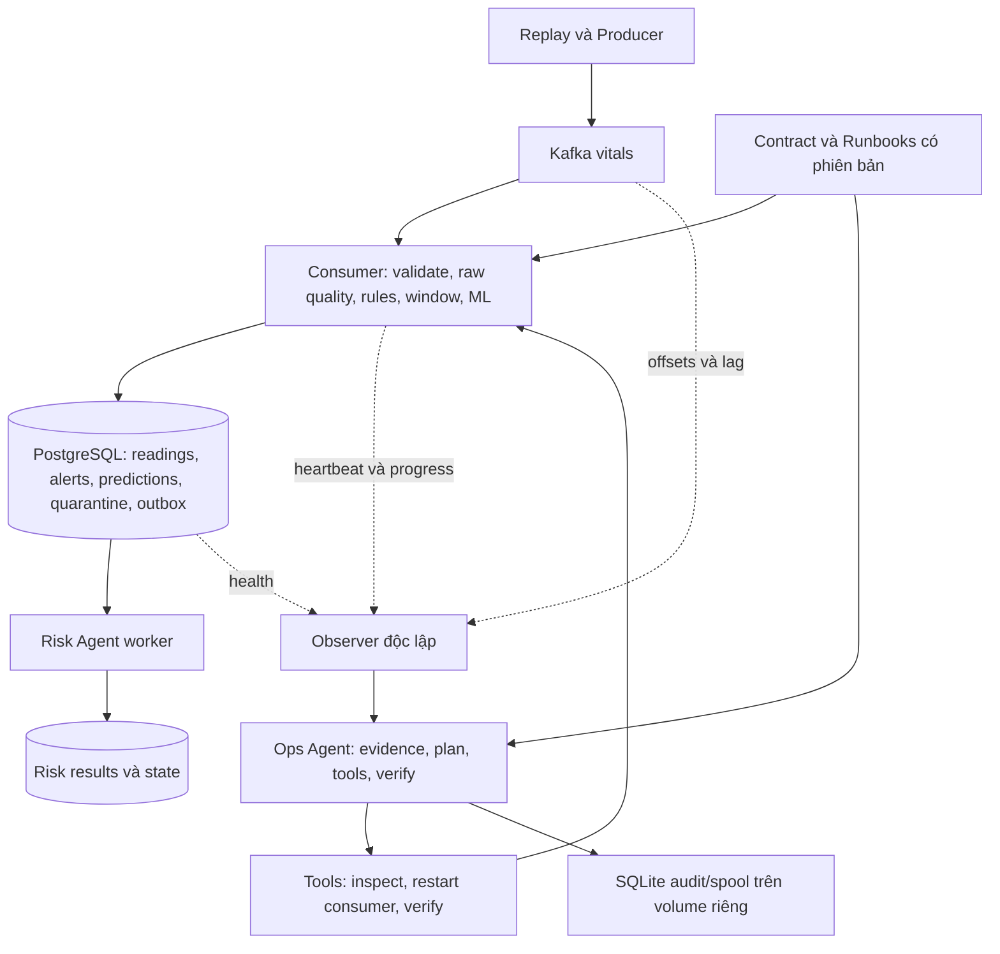

# Lộ trình 14 ngày tiến gần Hybrid 3

Thiết kế ngày 22/10/2026, theo quỹ thời gian 8–12 giờ/ngày. Ngày 1 là ngày bắt đầu do người thực hiện chọn. Đây là kế hoạch triển khai; các module, bảng, lệnh và kiểm thử được đề xuất dưới đây chưa được tạo bởi tài liệu này.

## 1. Đích đến sau 14 ngày

Một MVP có thể trình diễn và đối soát được:

1. Nhận sinh hiệu qua Kafka, lưu dữ liệu/cảnh báo với offset và chống trùng có chủ đích.
2. Đánh giá chất lượng raw, kiểm soát điều kiện inference, lưu prediction có provenance.
3. Có semantic context dạng cấu trúc: contract, ý nghĩa field/metric, model và runbook.
4. Observer và Ops Agent chạy độc lập với consumer; phát hiện treo, chọn hành động trong phạm vi xác định và kiểm tra kết quả.
5. Phục hồi consumer treo; xử lý DB lỗi tạm thời và bản ghi lỗi; phân biệt với nguồn ngừng/thiếu tín hiệu.
6. Có report fault, bằng chứng mất/trùng dữ liệu và timeline phục hồi.

Phạm vi mô tả: Streaming + dữ liệu phục vụ AI có kiểm soát + tự động hóa vận hành hướng agentic. Chưa triển khai Lakehouse. Bộ điều phối theo chính sách là baseline hữu ích; kết quả tự động hóa theo luật không được gọi thành năng lực suy luận tổng quát của AI.

### Bắt buộc và mở rộng

| Bắt buộc trong 14 ngày | Mở rộng khi đã qua các mốc nghiệm thu |
|---|---|
| Kafka/PostgreSQL hiện tại; transaction, idempotency, offset | Thêm storage/stream engine hoặc thay stack |
| Restart dùng warm-up có công bố; forecast UNKNOWN tới khi đủ điều kiện | Checkpoint window đầy đủ, continuity dự đoán qua mọi restart |
| Quality, feature parity trên bộ mẫu nhỏ, prediction provenance | Huấn luyện model mới, tạo bộ nhãn episode hoàn chỉnh và nghiên cứu lâm sàng |
| RiskEvent outbox, kết quả/state bền vững, một worker | Nhiều worker phân tán, workflow engine |
| Observer độc lập, planner theo evidence, tools giới hạn, verification | LLM chọn kế hoạch có cấu trúc sau khi baseline đã chạy ổn |
| JSON/Markdown report và biểu đồ nếu cần | Dashboard nhiều màn hình, vector database, RAG |

Giữ model hiện tại để đo tác động hệ thống. Ngày 7 xác minh metadata; nếu chưa xác nhận target/horizon, ghi rõ giới hạn và không tuyên bố model báo trước biến cố đã được kiểm chứng.

## 2. Quỹ giờ và cách sử dụng

- 14 ngày × 8 giờ cốt lõi = 112 giờ theo kế hoạch.
- Nếu trung bình 10 giờ/ngày: có 28 giờ dự phòng, tổng 140 giờ.
- Mức tối đa người dùng cho phép: 168 giờ. Không phân bổ hết 168 giờ cho tính năng mới.
- Mỗi ngày mặc định: 1 giờ đọc/thiết kế → 4 giờ triển khai → 2 giờ kiểm chứng → 1 giờ ghi bằng chứng/chốt việc.
- 2–4 giờ còn lại ưu tiên lỗi tích hợp, lượt chạy dài và học đúng phần bị vướng. Chỉ mở rộng tính năng khi đầu ra cốt lõi đã đạt.

Ước lượng giả định Docker/Kafka đang chạy được và người thực hiện có thể sửa Python/SQL. Phục hồi transaction/state là phần dễ vượt dự kiến nhất; có các nhánh thu hẹp phạm vi ở mục 8.

## 3. Kiến trúc và hợp đồng triển khai MVP

### Các quyết định giảm độ phức tạp

- Consumer xử lý tuần tự theo partition, batch transaction nhỏ. Khởi đầu một worker consumer; nhiều replay worker không đồng nghĩa nhiều consumer.
- Chỉ commit offset cao nhất đã hoàn tất liên tục của mỗi partition, theo giá trị next-offset. Một batch lỗi không cho commit vượt các đầu ra chưa bền vững.
- Transaction PostgreSQL chứa reading, alert/prediction phát sinh và outbox tương ứng. Message sai định dạng được cách ly bền vững trước khi tiến offset.
- Không gắn việc commit offset với việc Risk Agent đã giải thích xong: outbox bền vững là ranh giới tiếp nhận của nhánh agent.
- Sau restart/reassignment, window bắt đầu warm-up. Raw hợp lệ vẫn được rules đánh giá; forecast không đủ điều kiện phải trả UNKNOWN. Replay không âm thầm tạo lại đầu ra khác cho cùng sự kiện đã hoàn tất.
- Observer/Ops chạy ngoài consumer. MVP nên chạy bằng Python trên host, dùng Docker CLI với target cố định; tránh mất thêm thời gian xử lý Docker socket trong container. Khi chạy observer container, cần cấu hình quyền/tool executor riêng.
- Audit/incident/action của Ops lưu SQLite trên thư mục dữ liệu bền vững riêng, không phụ thuộc PostgreSQL đang được quan sát. Một Ops process cho MVP.
- Telemetry file dùng ghi nguyên tử và có boot ID, sequence, timestamp; observer không coi file cũ là service đang khỏe. Dùng monotonic clock cho timeout cục bộ; wall clock UTC cho đối chiếu các process.
- Input identity bền vững tách khỏi BENCH_RUN_ID. Có dataset/replay-session namespace được giữ qua restart; republish cùng sự kiện phải giữ ID. Run ID đo lường dùng liên kết report.

## 4. Kế hoạch từng ngày

### Ngày 1 — Chốt phạm vi và đo baseline (8 giờ)

**1 giờ:** đọc `README.md`, consumer, DB client, window và agent runtime; ghi lại tiến trình nào chạy ở đâu.

**4 giờ:** chạy baseline 1 case rồi 10 case; xác định bộ case thực sự có dữ liệu. Ghi model/config hash, số mẫu được nguồn xác nhận gửi, workload và tài nguyên máy. Chốt contract cho ID, timestamp gốc, timestamp replay, đơn vị và lỗi schema. Chọn một fault consumer hang và một fault DB unavailable cho bản demo.

**2 giờ:** chạy lại cùng workload để kiểm tra report/expected set ổn định; phân biệt probe tổng hợp với CSV dùng xem ML.

**1 giờ:** lưu `docs/hybrid3_mvp_scope.md`, `configs/data_contract.yaml`, manifest và report baseline ở vị trí đề xuất `logs/hybrid3/baseline/`.

**Nghiệm thu:** một reading có thể truy từ nguồn tới DB; biết số mẫu kỳ vọng và các ngưỡng đo. Không đặt mục tiêu hiệu năng dựa trên số chưa đo.

### Ngày 2 — Định danh và migration chống trùng (8 giờ)

**1 giờ:** chốt reading ID, alert ID và window/prediction ID. Viết rõ ý nghĩa khi chạy một phiên replay mới so với restart cùng phiên.

**4 giờ:** tạo migration có phiên bản, chạy thử trên DB thử nghiệm. Thêm unique key cho alert logic; chuẩn bị bảng quarantine, outbox, prediction và risk state/result. Hướng tối giản là JSONB cho payload kèm cột ID/version/status cần truy vấn. Kiểm tra timestamp và precision hiện có để tránh hai sự kiện khác nhau bị nhập chung.

**2 giờ:** ghi lại cùng alert nhiều lần; thử commit thành công nhưng client mất ACK bằng fault hook hiện có. Kiểm tra migration trên DB đã có dữ liệu; duplicate cũ phải được báo và có phương án riêng, không tự xóa dữ liệu lịch sử.

**1 giờ:** lưu data dictionary, ID specification và bằng chứng truy vấn.

**Nghiệm thu:** retry cùng sự kiện không tạo thêm hiệu ứng alert; migration áp dụng được trên DB test hiện có.

### Ngày 3 — Ranh giới transaction và flush (8 giờ)

**1 giờ:** vẽ một batch gồm readings, alerts, predictions và RiskEvents; xác định đầu ra bắt buộc.

**4 giờ:** thêm phương thức DB dùng chung một transaction cho batch và outbox; các hàm cũ hiện mở transaction riêng cần được nối lại đúng ranh giới. Tách flush interval khỏi window size. Khi DB lỗi, giữ nguyên pending outputs, không tính lại rồi phát sinh snapshot khác. Giới hạn buffer; backpressure không được làm vi phạm lịch poll/heartbeat Kafka.

**2 giờ:** fault trước commit, sau commit/mất ACK; kiểm tra toàn bộ batch có trạng thái nhất quán và retry idempotent. So sánh độ trễ với baseline ở cùng workload.

**1 giờ:** ghi transaction contract, retry và giới hạn buffer.

**Nghiệm thu:** không có tình huống alert/outbox bị coi là hoàn tất trong khi reading bắt buộc chưa lưu; latency thay đổi có số đo.

### Ngày 4 — Offset, quarantine và crash recovery (8 giờ)

**1 giờ:** chọn commit thủ công rõ ràng cho MVP; lập sơ đồ offset đã đọc/đã hoàn tất/đã commit.

**4 giờ:** cấu hình offset store/commit tường minh; commit theo partition sau khi output đã bền vững, không dùng offset poll mới nhất để commit bừa cả batch. Lỗi validation vào bảng quarantine với topic/partition/offset, payload hoặc tham chiếu/hash và reason. DB down thì quarantine cũng chưa hoàn tất. Revoke/reassign không commit dữ liệu đang pending; reset state partition theo chiến lược warm-up.

**2 giờ:** kill trước DB commit, sau DB commit/trước Kafka commit; khởi động lại cùng group/session. Chèn message lỗi giữa hai message tốt. Đối soát expected IDs; thử partition reassignment.

**1 giờ:** lưu fault timeline và truy vấn missing/duplicate.

**Nghiệm thu:** các kịch bản trên không bỏ qua output bắt buộc; mẫu lỗi được cách ly đúng một hiệu ứng logic; dữ liệu tốt tiếp tục xử lý.

**Mốc A:** chưa qua ngày này thì dành giờ dự phòng cho độ tin cậy, không bắt đầu tự động restart.

### Ngày 5 — Risk Agent bền vững và warm-up rõ ràng (8 giờ)

**1 giờ:** chốt vòng đời outbox: pending → processing/lease → completed hoặc retry/failed; một worker trong MVP.

**4 giờ:** worker đọc snapshot đã lưu, ghi result + state + trạng thái hoàn tất trong transaction phù hợp. Outbox được khôi phục khi worker restart; logging không phải bằng chứng duy nhất về kết quả. Sự kiện trùng/đến cũ có chính sách xác định. Sau restart consumer, quality ghi WARMUP như một reason và forecast UNKNOWN tới khi đủ điều kiện; rules trên raw hợp lệ tiếp tục.

**2 giờ:** kill worker sau khi nhận nhưng trước khi ghi result; restart và đối soát. Thử sự kiện trùng/cũ, thử warm-up không bị nhầm thành nguy cơ thấp. Hysteresis state đọc từ DB, có phiên bản và thứ tự sự kiện.

**1 giờ:** ghi quy trình phục hồi, giới hạn forecast continuity và số outbox pending.

**Nghiệm thu:** RiskEvent đã lưu không mất khi process dừng; một sự kiện có một kết quả logic; state và kết quả nhất quán.

### Ngày 6 — Raw quality và quality gate (8 giờ)

**1 giờ:** chốt required fields theo model, ngưỡng kỹ thuật cấu hình được và reason codes. Không tự sửa ngưỡng y tế.

**4 giờ:** đo raw missing/artifact/age trước fill; processed missing sau fill lưu riêng. Gate dùng freshness, số mẫu, độ phủ cửa sổ và required fields; phân biệt UNKNOWN, UNUSABLE, PARTIAL, GOOD theo hợp đồng. Consumer truyền quality thực thay cách gán PARTIAL chỉ vì có score. Lưu cả quyết định gate khi không có prediction để quan sát coverage.

**2 giờ:** thử thiếu một vài mẫu, thiếu kéo dài, artifact, timestamp tương lai và warm-up. Kiểm tra raw quality không thành GOOD chỉ nhờ forward-fill.

**1 giờ:** lưu bảng case → expected quality/reason → actual result.

**Nghiệm thu:** gate thay đổi theo bằng chứng; không suy ra an toàn từ thiếu dữ liệu; rules không bị tắt toàn bộ bởi lỗi nhánh ML.

### Ngày 7 — Provenance, feature parity và semantic context (8 giờ)

**1 giờ:** kiểm tra metadata bundle: target, feature order, preprocessing, model hash và horizon thực sự xác nhận được.

**4 giờ:** lưu prediction với window bounds, feature snapshot/version, model/config hash, source/session ID và quality. Tạo metadata YAML cho field/đơn vị/metric/table/model và runbook sơ bộ. Dùng logic feature chung để so offline/online trên một bộ mẫu cố định; chốt chính sách duplicate/out-of-order.

**2 giờ:** chọn một prediction và tái tính feature; thử parity với thiếu dữ liệu, timestamp trùng và đến muộn. Feature số thực dùng tolerance có giải thích. Metadata thiếu không được suy đoán thành target đã xác minh.

**1 giờ:** lưu manifest và report parity; ghi rõ phần đánh giá dự báo chưa đủ nhãn.

**Nghiệm thu:** truy nguyên được một score và một quyết định gate từ dữ liệu tới model; không có sai lệch feature chưa giải thích.

**Mốc B:** hết tuần 1 có nền tảng streaming đáng tin hơn và dữ liệu AI có kiểm soát. Đây là sản phẩm độc lập nếu phải thu hẹp tuần 2.

### Ngày 8 — Observer độc lập (8 giờ)

**1 giờ:** chốt schema telemetry: boot ID, sequence, last progress, heartbeat, buffer, DB errors, quality summary và lag.

**4 giờ:** consumer ghi telemetry ngoài chế độ benchmark; observer host đọc telemetry, Kafka offsets/lag và probe PostgreSQL có timeout. Nguồn phát có tín hiệu tiến độ để phân biệt không có input với consumer treo. Consumer hang không làm observer ngừng. Ops audit dùng SQLite, tiếp tục ghi được khi PostgreSQL lỗi.

**2 giờ:** thử telemetry cũ, file đang đổi, consumer ngừng, Kafka không truy vấn được, DB down, nguồn không phát. Thiếu bằng chứng phải hiện UNKNOWN; không gán lag 0 khi probe lỗi.

**1 giờ:** lưu snapshot khỏe và từng loại lỗi.

**Nghiệm thu:** observer nhận ra không có progress khi có công việc chờ; source idle được phân biệt với fault.

### Ngày 9 — Chẩn đoán và planner ở shadow mode (8 giờ)

**1 giờ:** định nghĩa incident và các trạng thái OBSERVING, SUSPECTED, CONFIRMED, PLANNED, ACTING, VERIFYING, RESOLVED, NEEDS_ATTENTION.

**4 giờ:** planner kết hợp progress, lag, nguồn, DB và worker health. Chọn giữa WAIT_AND_RECHECK, RESTART_CONSUMER, TRACK_DB_RECOVERY, RECORD_DATA_QUALITY và NEEDS_ATTENTION. Mỗi kế hoạch kèm evidence, precondition, expected result, timeout và runbook version. Thực thi shadow: ghi quyết định nhưng chưa gọi restart.

**2 giờ:** phát lại snapshots của consumer hang, DB down, backlog đang drain, nguồn dừng và sensor thiếu. Cùng một evidence phải có kết quả giải thích được. Tình huống chưa đủ bằng chứng đi vào quan sát thêm.

**1 giờ:** lưu confusion table nhỏ: tình huống thật → chẩn đoán → kế hoạch mong đợi/thực tế.

**Nghiệm thu:** không đề xuất restart consumer cho DB down, source idle hoặc thiếu một cảm biến.

### Ngày 10 — Tools và thực thi có giới hạn (8 giờ)

**1 giờ:** chốt danh sách tool và target; MVP chỉ có quyền restart consumer trong môi trường thử nghiệm.

**4 giờ:** tool inspect/restart/verify có input/output định kiểu, timeout và action ID. Dùng argv cố định cho Docker CLI, không nhận lệnh shell tùy ý từ planner. Lock theo target, cooldown và giới hạn số lần/incident. Ghi action intent bền vững trước lệnh, ghi kết quả sau; nếu Ops restart giữa hai bước phải inspect lại trước khi lặp hành động.

**2 giờ:** thử target ngoài danh sách, timeout, tool thất bại, incident trùng và Ops restart trong lúc action đang thực thi. Bật execution cho một fault consumer hang đã qua shadow.

**1 giờ:** lưu action audit và giới hạn cấu hình.

**Nghiệm thu:** một fault hợp lệ tạo hành động đúng; không có vòng restart vô hạn; kết quả tool mơ hồ dẫn tới đối soát thay vì lặp lệnh ngay.

### Ngày 11 — Xác minh phục hồi và chạy tích hợp (8 giờ)

**1 giờ:** định nghĩa HEALTHY sau phục hồi: progress mới, input còn hoạt động, backlog phù hợp và output bắt buộc được lưu; warm-up vẫn được báo riêng.

**4 giờ:** nối observe → diagnose → act → verify. Verifier dùng nhiều mẫu quan sát, không chỉ container running. Với DB lỗi: pipeline giữ dữ liệu/retry có backoff, Ops theo dõi dependency và tiến độ; khi DB trở lại thì xác minh drain. Với invalid schema: quarantine pipeline xử lý, Ops tổng hợp incident khi cần; không tuyên bố agent đã sửa schema. Failure không giải quyết được kết thúc NEEDS_ATTENTION.

**2 giờ:** chạy trọn consumer hang, DB unavailable/restored và invalid schema; kiểm tra observer còn sống và audit đủ timeline.

**1 giờ:** đóng tính năng cốt lõi, liệt kê lỗi còn lại.

**Nghiệm thu:** demo tự phục hồi consumer hang chạy được; DB recovery được quan sát đúng, không quy hành động restore của fault controller cho agent.

**Mốc C:** nếu chưa có demo end-to-end thì dùng toàn bộ ngày 12–14 cho sửa và kiểm chứng; bỏ mọi mở rộng.

### Ngày 12 — Fault benchmark có đối chứng (8 giờ)

**1 giờ:** khóa data/config/model/workload/fault manifest và cutoff quan sát trước khi chạy.

**4 giờ:** chạy 1 case smoke rồi workload 10 case. So sánh A = nền tảng mới + Docker restart policy/retry hiện có, B = cùng nền tảng + Ops supervisor/planner. Fault suite: consumer hang, crash tại ranh giới commit, DB lỗi tạm thời, message sai, nguồn idle và thiếu tín hiệu. Lặp ban đầu 3 lần cho các fault chính, chạy tuần tự để tránh nhiễu.

**2 giờ:** đối soát expected với DB sau drain, kiểm tra duplicate logical IDs và false restart. Thiết lập fault/state đồng nhất giữa chế độ, tách session/run namespace để không lẫn dữ liệu. Báo số case không chạy được thay vì coi là pass.

**1 giờ:** lưu bảng kết quả và trace đi kèm.

**Nghiệm thu:** có bằng chứng so sánh thực tế; không loại bỏ cơ chế restart sẵn có để làm baseline yếu đi. Nếu thêm LLM sau này, so sánh riêng với planner xác định trên cùng nền tảng.

### Ngày 13 — Report dễ đọc và gói demo (8 giờ)

**1 giờ:** chọn câu chuyện demo và chỉ số quan trọng.

**4 giờ:** tổng hợp report JSON/Markdown; thêm biểu đồ timeline nếu giúp xem fault/detection/action/recovery. Hiển thị quality/gate, prediction provenance, lag/progress và incident/action. Chuẩn hóa runner/config để tránh nhập tay nhiều biến môi trường. Chuẩn bị bộ dữ liệu demo đủ quyền sử dụng.

**2 giờ:** chạy lại quy trình từ start services → migration → replay → fault → report trên DB test. Đối chiếu số liệu report với trace/DB.

**1 giờ:** viết README demo và ghi hạn chế.

**Nghiệm thu:** một người làm theo hướng dẫn chạy lại được và hiểu vì sao hệ thống coi là đã phục hồi.

### Ngày 14 — Ngày dự phòng, nghiệm thu và diễn tập (8 giờ)

**1 giờ:** rà toàn bộ checklist, chốt lỗi cần sửa để demo tái hiện được.

**4 giờ:** sửa các lỗi đã phát hiện, không thêm tính năng mới; chạy lượt nghiệm thu cuối. Nếu không có lỗi, dùng thời gian tăng số lần lặp và xác nhận ở workload cao hơn có kiểm soát; không ghi tải chưa thử thành năng lực hệ thống.

**2 giờ:** diễn tập hai demo: consumer hang → phục hồi, sensor thiếu → không restart sai. Ghi hình nếu công cụ/môi trường cho phép, hoặc lưu trace/report hoàn chỉnh.

**1 giờ:** chốt hướng dẫn, kết quả, giới hạn và backlog sau 14 ngày.

**Nghiệm thu:** có code, migration, config, dữ liệu demo/manifest, report, fault timeline và hướng dẫn tái lập cho đúng phiên bản.

## 5. Bản đồ file đề xuất

Giữ tên dễ hiểu và ít module. Đây là gợi ý tổ chức, không bắt buộc tạo mọi file từ ngày đầu.

| File/thư mục | Trách nhiệm | Ngày |
|---|---|---|
| `configs/data_contract.yaml` | Schema, identity, clock, units, version | 1–2 |
| `db/migrations/` | Migration có phiên bản và kiểm tra trước khi chạy | 2–3 |
| `src/realtime_medical/db/client.py` | Transaction và ghi idempotent | 2–4 |
| `src/realtime_medical/streaming/consumer.py` | Validation, completion, offset, telemetry | 3–8 |
| `src/realtime_medical/agent/runtime.py`, `worker.py` | Outbox, durable results/state | 5 |
| `src/realtime_medical/streaming/quality.py` | Raw quality và gate, có thể chia sẻ helper hiện có | 6 |
| `src/realtime_medical/streaming/windowing.py` | Quality raw/processed, warm-up, feature parity | 5–7 |
| `configs/semantic_context.yaml`, `configs/ops.yaml` | Metadata và chính sách/runbook | 7–10 |
| `src/realtime_medical/ops/observer.py` | Thu thập evidence độc lập | 8 |
| `src/realtime_medical/ops/planner.py` | Chẩn đoán, chọn kế hoạch theo evidence | 9 |
| `src/realtime_medical/ops/tools.py` | Tool executor có giới hạn | 10 |
| `src/realtime_medical/ops/runtime.py` | Incident state, SQLite audit, verification | 9–11 |
| `scripts/run_ops.py` | Khởi động Ops ở host | 8–11 |
| `scripts/run_hybrid3_demo.py` | Điều phối demo, không trộn với planner vận hành | 12–13 |
| `scripts/report_hybrid3.py` | Tổng hợp report từ trace/DB/audit | 12–13 |
| `test/` | Test crash/retry/gate/planner và fault integration có ý nghĩa | Theo ngày |

Schema tối thiểu ngoài bảng sẵn có: `quarantined_events`, `risk_event_outbox`, `risk_agent_results`, `risk_agent_state`, `prediction_runs`, `predictions`. Gate decisions có thể lưu cùng prediction evaluation record với score nullable; không cần lập nhiều bảng quality ngay. Ops SQLite có incident/action/evidence tables. Chốt schema thực tế ngày 2, mở rộng bằng migration khi cần.

## 6. Chính sách Ops MVP

| Bằng chứng | Chẩn đoán | Phương án | Dấu hiệu xác minh |
|---|---|---|---|
| Input/lag xác nhận có việc chờ, consumer không tiến triển, DB/Kafka khỏe | Consumer có thể bị treo | Restart consumer giới hạn sau cửa sổ xác nhận | Boot/progress mới, output tăng; backlog phục hồi phù hợp tốc độ nguồn |
| DB probe lỗi và lỗi ghi tăng | Dependency DB không sẵn sàng | Theo dõi/backoff, không restart consumer liên tục | DB truy cập lại được, output tăng, pending giảm sau drain |
| Payload lỗi validation | Bad record | Pipeline cách ly, Ops ghi sự cố/tỷ lệ lỗi | Quarantine bền vững; reading hợp lệ phía sau được xử lý |
| Chỉ một field stale/missing, pipeline vẫn tiến triển | Data-quality incident | Gate và ghi lý do | Quality đúng, không có restart không cần thiết |
| Nguồn ngừng, không có lag đáng tin cậy cho biết backlog | Source idle hoặc thiếu bằng chứng | Wait/recheck | Không restart do đơn thuần không có input |
| Kafka không truy vấn được | Quan sát chưa đủ/dependency Kafka lỗi | Ghi UNKNOWN, probe lại có timeout | Chỉ quyết định khi có bằng chứng đủ |

Ngưỡng đầu tiên là tham số thử nghiệm, chọn sau baseline và khóa trước benchmark cuối. Có thể bắt đầu heartbeat/probe khoảng 2 giây, xác nhận qua nhiều mẫu; phải tính theo polling/backoff/flush thực để tránh chẩn đoán giả. Không coi các giá trị khởi đầu là chuẩn ngành.

Nếu phải thêm LLM để nghiên cứu lựa chọn kế hoạch: dùng evidence + runbook có phiên bản, output JSON schema, validator và tool allowlist. Chỉ thêm trong giờ dự phòng sau mốc C; planner xác định vẫn làm fallback và đối chứng. Khi không đủ thời gian, hoàn thiện baseline và mô tả mức tự động hóa thực tế.

## 7. Bộ nghiệm thu và bằng chứng cuối kỳ

| Nhóm | Điều kiện đạt trong phạm vi test |
|---|---|
| Reading/alert | Expected IDs được đối soát sau drain; không có duplicate effect theo logical ID |
| Offset | Crash trước/sau DB commit không bỏ qua output bắt buộc; commit không vượt pending |
| Quarantine | Invalid record không biến mất âm thầm hoặc chặn vĩnh viễn các mẫu tốt |
| Risk Agent | Pending sự kiện được nhận lại; result/state nhất quán sau worker restart |
| Quality | Raw missing không bị che bởi fill; gate UNKNOWN/UNUSABLE có lý do |
| Prediction | Lần theo được source → feature snapshot → model/config → score/gate |
| Ops | Treo consumer được phát hiện và phục hồi; observer sống độc lập; audit đủ |
| Hành động sai | Source idle và sensor thiếu không gây restart trong fault suite |
| Phục hồi | Progress/output và dữ liệu được kiểm tra; warm-up forecast được báo riêng |
| Tái lập | Manifest, config, model hash, fault schedule, commands và report khớp nhau |

Các số phải báo: detection delay, total interruption từ onset, recovery delay từ lúc dependency khả dụng, mất/trùng sau drain, deadline persistence, số restart/incident, false actions và coverage ML. Báo đầy đủ số lượt chạy, trường hợp thất bại và thời gian quan sát. Phân biệt source time/replay wall time để không tính sai latency.

Thiết kế benchmark không cần hứa trước một RTO cố định: chọn mục tiêu từ số nền rồi giữ nguyên định nghĩa. RTO khi container running và RTO khi forecast hết warm-up là hai điểm khác nhau.

## 8. Nếu chậm tiến độ

- **Cuối ngày 4 chưa qua crash/offset:** dùng giờ dự phòng ngày 5–7 và hoãn phần metadata đẹp/giao diện; giữ warm-up thay checkpoint. Nếu cơ chế lưu chưa chắc, Ops chỉ shadow, chưa tự restart.
- **Cuối ngày 7 còn lỗi quality/parity:** thu hẹp required fields theo contract của model; ghi rõ coverage và giới hạn. Không tự đổi feature order hoặc train nhanh một model khác để che lỗi.
- **Cuối ngày 10 tool chưa ổn:** MVP chỉ xử lý consumer hang; DB down/invalid/schema/sensor dùng quan sát, retry/quarantine sẵn có và report. Bỏ LLM.
- **Cuối ngày 11 chưa có vòng end-to-end:** ngày 12–14 chỉ sửa và nghiệm thu consumer hang + sensor missing; chưa công bố các fault còn lại đã hỗ trợ.
- **Không có nhãn dự báo đáng tin:** vẫn hoàn thiện quality/provenance/parity, ghi rõ chưa đánh giá năng lực early-warning. Nghiên cứu model chuyển sang đợt sau.

## 9. Các việc làm sau 14 ngày

Checkpoint window/state đầy đủ; target/label và đánh giá ML theo patient/episode; LLM planner có đối chứng; nhiều consumer/worker; monitoring dài hạn; kiểm thử fault rộng hơn. Lakehouse có thể thêm sau dựa trên contract, ID, version và lineage tối thiểu đã xây.

## 10. Nguồn kỹ thuật đối chiếu

- [Confluent Kafka Python API 2.3.0](https://docs.confluent.io/platform/7.5/clients/confluent-kafka-python/html/index.html), khớp phiên bản client đang pin trong dự án.
- [Confluent Python client: offset và delivery guarantees](https://docs.confluent.io/kafka-clients/python/current/overview.html), dùng phần nguyên lý; không áp dụng API mới mà chưa kiểm tra compatibility.

Kafka offset và transaction PostgreSQL là hai ranh giới riêng. Kế hoạch chọn lưu DB trước, commit offset sau, cho phép replay và chống trùng; không tuyên bố exactly-once xuyên hai hệ thống.
