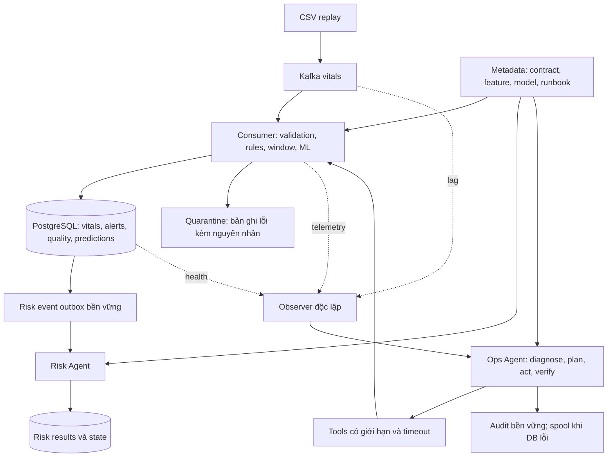

# Lộ trình tiến gần Hybrid 3, chưa triển khai Lakehouse

> Cập nhật theo yêu cầu mới: kế hoạch thực hiện hiện hành là [Lộ trình 14 ngày, 8–12 giờ/ngày](LO_TRINH_14_NGAY_HYBRID_3.md). Tài liệu này giữ vai trò tham khảo thiết kế dài hạn; lịch 8–10 tuần và phạm vi mở rộng bên dưới đã được thay thế cho đợt MVP này.

Ngày thiết kế: 22/10/2026. Đối chiếu mã nguồn trong repository hiện tại. Đây là kế hoạch đề xuất, chưa phải các chức năng đã triển khai.

## 1. Mục tiêu và phạm vi

Xây dựng hệ thống streaming có dữ liệu đầu vào AI được kiểm soát, metadata có ngữ nghĩa và agent vận hành có thể phát hiện, chọn cách xử lý, thực thi và xác minh phục hồi một số lỗi xác định trước.

Giữ Python, Kafka, PostgreSQL, XGBoost và Docker Compose. PostgreSQL dùng cho dữ liệu, metadata và trạng thái bền vững trong phạm vi thử nghiệm. Lakehouse được hoãn; thành quả mô tả là “Streaming + AI-ready data + agent hỗ trợ vận hành, định hướng Hybrid 3”.

Hai vai trò riêng:

- Risk Agent hiện tại: tổng hợp rules, điểm ML, chất lượng và giải thích cảnh báo sinh hiệu.
- Ops Agent mới: quan sát pipeline và xử lý sự cố kỹ thuật. Các hành động vận hành không được sửa ngưỡng sinh hiệu, model score hoặc hạ mức cảnh báo rules.

Giả định kế hoạch: một người đã hiểu Python/SQL cơ bản, làm khoảng 15–20 giờ/tuần, trong 8–10 tuần. Đây là ước lượng lập kế hoạch; độ khó khôi phục state và chất lượng nhãn có thể làm tăng thời gian.

## 2. Điểm xuất phát trong mã nguồn

| Thành phần | Hiện trạng quan sát được | Việc cần phát triển |
|---|---|---|
| Consumer | Nhận Kafka, rules, sliding window, ML, buffer và flush PostgreSQL | Offset gắn với hoàn tất xử lý bền vững; tách flush interval khỏi window size |
| Kafka config | Chỉ cấu hình broker, group, auto.offset.reset=latest trong consumer | Quy định offset store/commit, rebalance, replay và lỗi không có offset |
| Cảnh báo | Retry sau lỗi; schema dùng alert_id tự tăng | ID logic ổn định và unique constraint để retry không tạo bản ghi cảnh báo trùng |
| Window | Feature tính sau lọc/forward-fill | Lưu chất lượng raw riêng; khôi phục window hoặc đánh dấu warm-up |
| Risk Agent | Worker nền trong process consumer; queue/state trong RAM; xuất log | Inbox/outbox hoặc nguồn sự kiện bền vững; kết quả và trạng thái có thể phục hồi |
| Chất lượng gửi agent | Consumer gán PARTIAL nếu có score, UNKNOWN nếu không có | Suy ra từ bằng chứng thực về missingness, độ mới và độ phủ cửa sổ |
| Observability | Có metrics, trace, fault injection; SignalMonitor gắn với chế độ metrics | Telemetry vận hành liên tục và observer độc lập với consumer |
| Model | Có bundle XGBoost và inference | Manifest dữ liệu/feature/model; kiểm chứng target, horizon và chất lượng bằng nhãn |

File chính: `streaming/consumer.py`, `streaming/windowing.py`, `db/client.py`, `agent/runtime.py`, `agent/nodes.py`, `utils/signal_monitor.py`, dưới `src/realtime_medical/`; cùng `db/schema_1.sql` và `scripts/run_pipeline.py`.

## 3. Kiến trúc đích

Observer và Ops Agent chạy ngoài process/container consumer. Khởi đầu có thể là một service Python riêng trong Compose. Risk Agent có thể tiếp tục cùng process nếu có cơ chế phục hồi; phải ghi rõ nó vẫn bị ảnh hưởng khi consumer dừng.

Quarantine cần đích bền vững trước khi coi bản ghi lỗi đã được xử lý. Chọn một cách cho MVP: bảng PostgreSQL hoặc Kafka DLQ; thiết kế retry/idempotency tương ứng.

## 4. Giai đoạn 1 — Chốt hợp đồng và đo baseline (tuần 1)

### Công việc

- Chốt định danh reading, alert, window, prediction và run; phân biệt patient_id với surgery_id.
- Định nghĩa source/event time, thời điểm replay phát, receive time, persist time. Giữ timestamp gốc để truy nguyên, tách clock dùng phát lại để không đánh giá dữ liệu lịch sử là stale một cách sai lệch.
- Định nghĩa schema, đơn vị, nullable, khoảng giá trị hợp lệ, phiên bản và cách xử lý lỗi.
- Khóa bộ case và cấu hình baseline; tách dữ liệu sinh hiệu thật trong CSV khỏi probe tổng hợp dùng đo deadline.
- Đo latency, throughput, buffer, lag, tuổi tín hiệu, lỗi ghi và duplicate. Tách detection khỏi persistence và delivery nếu sau này có kênh gửi.
- Đặt SLO thử nghiệm sau khi có số nền; các ngưỡng là mục tiêu nội bộ, có workload và điểm bắt đầu/kết thúc rõ ràng.

### Sản phẩm và điều kiện hoàn thành

Data contract, từ điển dữ liệu, cấu hình baseline và report có thể tái hiện. Lần theo được một reading từ CSV đến DB và giải thích từng metric. Chưa thay model đồng thời với đo baseline.

## 5. Giai đoạn 2 — Làm chắc lưu trữ và phục hồi (tuần 2–3)

### Công việc

- Tách `flush_interval_seconds` khỏi `window_size_seconds`; chọn bằng đo độ trễ và tải DB.
- Tạo logical alert ID ổn định, có unique constraint; xử lý retry sau tình huống DB commit nhưng client mất ACK.
- Quản lý offset tường minh: chỉ đánh dấu hoàn tất khi đầu ra bắt buộc đã lưu bền vững hoặc đã được cách ly bền vững. Theo dõi dải offset hoàn tất liên tục cho từng partition; không commit vượt message còn lỗi vì message sau đã xong.
- Với PostgreSQL và Kafka, dùng thứ tự lưu DB trước rồi commit offset, chấp nhận replay và chống trùng ở sink. Không gọi đây là giao dịch exactly-once xuyên cả hai hệ thống.
- Lưu RiskEvent vào outbox cùng transaction của dữ liệu liên quan; worker nhận lại sau restart. Dedup, cập nhật state và lưu kết quả cần ranh giới transaction rõ; nếu có publish ngoài DB cần outbox/idempotency riêng.
- Chọn một chiến lược window: checkpoint nhất quán với tiến độ xử lý hoặc tái dựng từ lịch sử đã lưu. Nếu chưa hỗ trợ continuity, khai báo warm-up và không dùng forecast đến khi đủ điều kiện; ghi rõ giới hạn này.
- Phục hồi hysteresis/dedup state hoặc quy định reset có chủ đích; không chỉ phục hồi window mà bỏ qua trạng thái Risk Agent.

### Sản phẩm và điều kiện hoàn thành

Kiểm thử crash tại trước DB commit, sau DB commit/trước offset commit, mất ACK và rebalance. Trong phạm vi test, đối soát đủ expected reading, không tạo hiệu ứng cảnh báo trùng; forecast sau restart tương đương replay liên tục hoặc được đánh dấu warm-up đúng hợp đồng.

Kiểm chứng mất/trùng tại cutoff và sau drain; không suy ra “mất vĩnh viễn” chỉ từ một lần quá deadline.

## 6. Giai đoạn 3 — AI-ready data và semantic context (tuần 4–5)

### Công việc

- Lưu raw quality trước forward-fill: missing mask, tỷ lệ thiếu, artifact flag, tuổi mẫu hợp lệ và mức phủ thời gian. Lưu processed quality riêng.
- Quality gate trả trạng thái có lý do; dùng trạng thái đó ở cả inference và Risk Agent. Trạng thái UNKNOWN/UNUSABLE phải phân biệt với điểm dưới ngưỡng.
- Lưu prediction kèm window bounds, model version/hash, feature version, quality, score, nguồn dữ liệu và config version. Lưu đủ đầu vào hoặc tham chiếu tới dữ liệu bất biến để tái lập feature; chỉ version string là chưa đủ.
- Dùng chung logic tạo feature offline/online và kiểm tra parity trên cùng dữ liệu, gồm mẫu thiếu, timestamp trùng, đến muộn và thứ tự không đúng. Chốt chính sách late/out-of-order.
- Xác minh model bundle thật sự học target/horizon nào. Trước khi có bằng chứng, mô tả score theo target đã xác nhận và coi early-warning là giả thuyết cần đánh giá.
- Xây nhãn và split theo bệnh nhân; chọn tham số trên validation, khóa test. Nếu target là biến cố tương lai, đánh giá theo episode, lead time, false alerts/giờ và coverage với baseline phù hợp.
- Tạo semantic context có phiên bản: định nghĩa field/metric, quan hệ bảng, ý nghĩa score, điều kiện quality và runbook. Bắt đầu bằng YAML/JSON và bảng metadata; tra cứu cấu trúc là đủ cho MVP.

### Sản phẩm và điều kiện hoàn thành

Truy nguyên được một prediction về dữ liệu, feature và model. Thử thiếu tín hiệu làm gate đổi đúng; rules vẫn đánh giá các trường raw hợp lệ. Có report parity và đánh giá có nhãn; không kết luận mô hình tốt chỉ vì điểm tăng.

Gợi ý bảng theo nhu cầu, có thể gộp ở MVP: `prediction_runs`, `predictions`, `data_quality_events`, `risk_event_outbox`, `risk_agent_state`, `risk_agent_results`. Dùng migration; không chỉ sửa file SQL khởi tạo rồi kỳ vọng DB cũ tự đổi.

## 7. Giai đoạn 4 — Quan sát liên tục và chẩn đoán độc lập (tuần 6)

### Công việc

- Telemetry bật độc lập với BENCH_ENABLED: heartbeat, thời điểm progress gần nhất, lag theo partition, tốc độ xử lý/nguồn, DB failures, buffer depth, queue depth và signal age.
- Phân biệt liveness với progress. Healthcheck hiện kiểm tra kết nối socket chưa đủ để phát hiện vòng xử lý bị treo.
- Observer đọc tín hiệu bên ngoài consumer; khi Kafka/DB mất kết nối, ghi trạng thái quan sát không đầy đủ thay vì gán metric bằng 0.
- Phân biệt: nguồn không phát; consumer treo; consumer đang drain backlog; DB lỗi; dữ liệu sai schema; một cảm biến bị thiếu.
- Dùng cửa sổ quan sát và hysteresis để hạn chế báo động chập chờn; ngưỡng chọn từ baseline ở từng tải.
- Ghi incident kèm evidence snapshot và runbook version. Audit khi DB hỏng dùng spool bền vững rồi đồng bộ lại.

### Sản phẩm và điều kiện hoàn thành

Dashboard hoặc report sự cố cho thấy input, progress, quality và tình trạng các service. Observer vẫn phát hiện được consumer bị treo; nguồn ngừng phát hoặc thiếu một field không bị chẩn đoán nhầm thành consumer cần restart.

## 8. Giai đoạn 5 — Ops Agent và phục hồi có kiểm chứng (tuần 7–8)

### Công việc

- Vòng xử lý: observe → diagnose → chọn kế hoạch → kiểm tra điều kiện → thực thi tool → verify → kết thúc hoặc chuyển xử lý thủ công.
- Chạy shadow mode trước: ghi kế hoạch và lý do nhưng chưa thực thi. Dùng fault suite kiểm tra quyết định; sau đó mới bật hành động trong môi trường thử nghiệm.
- MVP có 3 lớp lỗi: consumer mất tiến triển; DB tạm thời không truy cập được; bản ghi sai schema. Tái sử dụng retry/DLQ từ nền tảng; Ops Agent đánh giá tình trạng và điều phối thay vì tạo đường ghi dữ liệu song song.
- Tool có input/output định kiểu, danh sách target cố định, timeout, khóa theo incident/target, action ID, giới hạn retry và cooldown. Ghi action intent trước khi thực thi và đối soát khi agent restart; tránh lặp restart vì mất kết quả tool.
- Với consumer treo: chỉ restart khi có bằng chứng công việc cần xử lý và dependency đủ khỏe. Với DB down: giữ dữ liệu chờ bền vững, retry có backoff và xác minh khi DB trở lại; không restart consumer lặp để chữa DB.
- Khi một field cảm biến thiếu: ghi data-quality incident và hạn chế forecast theo gate; không “chữa” bằng cách giả dữ liệu hoặc restart hệ thống vô cớ.
- Verify bằng progress mới, lag có xu hướng phục hồi ở workload đã chốt, đối soát dữ liệu và độ trễ; trạng thái container running riêng lẻ chưa đủ.

### Mức độ agentic cần mô tả trung thực

Một vòng if/else cố định với restart là tự động hóa theo chính sách. Có thể dùng nó làm baseline và lớp giới hạn hành động. Để nghiên cứu tính agentic, cần chứng minh bộ điều phối dùng nhiều bằng chứng, chọn giữa các kế hoạch và điều chỉnh khi công cụ thất bại. Nếu thêm LLM, cho nó chọn kế hoạch có cấu trúc từ runbook, qua validator; so sánh với bộ điều phối xác định. LLM là lựa chọn mở rộng, không phải điều kiện để hoàn thiện phần nền tảng.

### Sản phẩm và điều kiện hoàn thành

Mỗi incident có timeline bằng chứng → giả thuyết → kế hoạch → tool result → verification. Fault không biết hoặc hết ngân sách xử lý phải kết thúc rõ ràng; không tạo vòng restart vô hạn.

## 9. Giai đoạn 6 — Thí nghiệm đối chứng và demo (tuần 9–10, tùy thời gian)

### Thiết kế so sánh

| Chế độ | Mục đích |
|---|---|
| A. Cơ chế đang có: Docker restart policy và retry | Đường cơ sở vận hành; không tắt cơ chế sẵn có để làm baseline yếu đi |
| B. Cùng nền tảng đã cải tiến + supervisor xác định | Đo hiệu quả tự động hóa theo runbook |
| C. Cùng nền tảng + Ops Agent | Đo giá trị thêm của chẩn đoán/chọn kế hoạch thích ứng |

Tách benchmark trước/sau thay đổi nền tảng khỏi so sánh B/C. Giữ cố định dữ liệu, workload, model, offset/state policy và lịch fault cho B/C. Nếu chưa triển khai bộ điều phối thích ứng, chỉ báo kết quả tự động hóa theo chính sách.

### Fault suite tối thiểu

1. Crash consumer ở điểm transaction xác định: kiểm tra offset, duplicate và state sau restart.
2. Treo vòng xử lý trong khi container còn running: kiểm tra observer và phương án restart.
3. DB mất kết nối tạm thời: kiểm tra giữ dữ liệu, retry và thời điểm pipeline thật sự phục hồi.
4. Mẫu sai schema xen giữa mẫu hợp lệ: kiểm tra cách ly bền vững và tiến độ partition.
5. Mất một field cảm biến, nguồn ngừng hoặc dữ liệu đến muộn: kiểm tra không hành động sai và gate hoạt động đúng.

Fault controller phải độc lập. Nếu controller tự khôi phục DB/mạng sau thời gian định sẵn, chỉ quy công cho agent ở phần nó thực sự làm; báo riêng thời điểm fault onset, dependency restored và pipeline recovered.

### Metric và điều kiện kết thúc

- Thời gian phát hiện, thời gian từ dependency khả dụng tới pipeline khỏe và tổng gián đoạn từ onset.
- Lost/duplicate effects theo tập expected, backlog và deadline persistence sau fault.
- Tỷ lệ incident xử lý thành công, chẩn đoán sai, hành động không cần thiết, số restart/incident.
- Chi phí CPU/RAM; nếu thêm LLM, đo latency, lỗi kế hoạch và chi phí gọi.
- Chất lượng ML: theo target/horizon đã xác nhận, cùng coverage và chất lượng đầu vào; tách khỏi metric hệ thống.

Lặp 3–5 lượt ban đầu mỗi kịch bản để thấy dao động, báo cấu hình và trường hợp thất bại. Mục tiêu định lượng chọn sau baseline và ghi trước lượt đánh giá cuối; không coi con số mục tiêu là kết quả đã đạt.

Demo: phát dữ liệu → gây treo consumer → observer phát hiện → Ops Agent chọn phương án → phục hồi → đối soát reading/alert → hiển thị quality, prediction và incident timeline. Kèm demo thiếu tín hiệu để chứng minh hệ thống không restart sai.

## 10. Backlog mở đầu và điểm dừng hữu ích

Thứ tự ticket đề xuất:

1. Chốt data contract, ID và ngữ nghĩa thời gian replay.
2. Lưu baseline có cấu hình và dữ liệu xác định.
3. Tách flush timer khỏi window; đo lại latency/tải DB.
4. Thêm logical alert ID, unique constraint và kiểm thử mất ACK.
5. Thiết kế completion/offset theo partition, transaction và phục hồi window/state.
6. Thêm RiskEvent outbox và lưu kết quả/state agent bền vững.
7. Thêm raw quality, quality gate và prediction provenance.
8. Làm feature parity, xác minh model target và bộ đánh giá có nhãn.
9. Thêm observer độc lập, metadata/runbook và incident audit.
10. Ops Agent shadow mode → thực thi giới hạn → thí nghiệm đối chứng.

Nếu thời gian hạn chế, thu hẹp MVP vào một lỗi consumer treo và một trường hợp thiếu tín hiệu để kiểm tra hành động sai. Hoàn thành đầy đủ observe/decide/act/verify cho phạm vi nhỏ trước khi mở rộng.

Kết quả kỳ vọng: hệ thống streaming có dữ liệu AI truy nguyên được và khả năng vận hành tự động có bằng chứng. Lakehouse có thể bổ sung về sau mà không làm lại các hợp đồng dữ liệu, định danh, phiên bản và audit đã thiết kế.

## 11. Tài liệu kỹ thuật đối chiếu

- [Confluent Python client: xử lý, offset và delivery guarantees](https://docs.confluent.io/kafka-clients/python/current/overview.html). Phần nguyên lý; không sao chép API mới mà chưa đối chiếu dependency đang pin.
- [confluent-kafka API 2.3.0, khớp requirements hiện tại](https://docs.confluent.io/platform/7.5/clients/confluent-kafka-python/html/index.html).

Offset chỉ tiến sau khi xử lý thành công chưa tự bảo đảm exactly-once với DB ngoài Kafka. Cần phối hợp idempotency, transaction, checkpoint/state và kiểm thử crash trong phạm vi hợp đồng.
